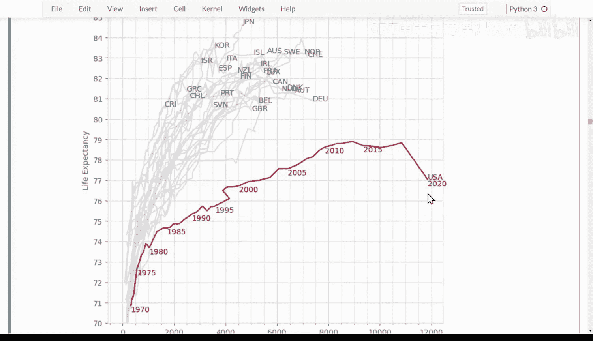

# 杜克大学《应用Python数据工程（3课全）｜Applied Python Data Engineering》中英字幕 p115 16_02_04_使用Pandas创建折线图.zh_en -BV1nz421i7KP_p115-

Okay， what I want to recreate is this plot right here， This is from our world in data。

 This is a plot of life expectancy against health expenditure per capita。

 You can see that this is telling a story or wants to tell a story that the US spends a lot。

 much more than other countries for a much worse result in that the life expectancy in the US is shorter than in other countries。

 but they are spending a lot more。 This is highlighted by the fact that we have a red line and everything else is a muted gray line this brings attention to USA。

Also note that there might be some connotation here using a red line generally red indicates bad in a lot of countries and that might be that。

US is bad， in this case。Okay， I'm going to load the map plotlib library。

 I'm also loading the Numpy library and the pandas library。 I'm going to load my data。

 You can see I've got the URLs where the data was fetched from。 And once we have that。

 I'm going to want to merge these data sets。 One is spending data and the other one is life expectancy data。

Here's what the merge result looks like， you can see that we've got 50，000 rows and 14 columns there。

Okay， let's clean this up a little bit。We're going to have this tweak data function。

 I'll go over what's happening in it。 We're passing in both of our data frames that we loaded。

 and we're going to take the spending data frame and we're going to do query。

 We're going to say we want to query where the measure is equal to USD cap and the subject is equal to Tt。

 This will filter out any row that doesn't have the column measure equal to USD cap or subject equal to Tt。

 Then we're going to group by time and location， and we're going to pull out the first entry for each of those groups。

 and then we're going to pull off the value column from that。

 We're going to rename that value column to spending USD。

 and then that is a series we're going to convert that to a data frame。 So at this point。

 we should have a data frame with time and location in the index and a single column called spending USD。

 We're going to merge that with our life expectancy。And our life expectancy。

 we're going to get by grouping time and location， pulling off the value。

Calculating the mean of that and then changing that column name to life expectancy。

 converting that to a frame。After we're done with that， we will reset the index。

So here's what that looks like when we're done with that。 you can see that we have a time column。

 We have a location。 Those are not in the index because we called reset index。

 and then we have the spending in US dollars and the life expectancy。

 This next entry here is just going to save those as a CSV file so that we can use that later。Okay。

 so here is a basic plot using pandas I'm going to say I want to group by location。

 note that location is the country and then I'm going to apply this plot function to each of the groups。

 which will be a subset of the data frame and it will be each country so with each subset I want to plot in the X axis。

 the spending and in the y axis the life expectancy。Let's see what that looks like。

And there's the result。Not the prettiest plot， but also not very many lines of code to get that。

I will note that this plot is somewhat difficult to do in other tools just because if you look at it。

 it's not monotonically increasing， you can see that these lines can go back to the left。

 they can go up and down and a lot of tools make that a little bit more difficult to make plots like this。

 but using the pandas library， it's somewhat straightforward。

One thing we might want to do is to mute the lines that we're not interested in and highlight the one that we are。

 in this case， there's the US and we're muting those other ones。

 Let's just step through the code very quickly here in my plot function。

 I'm saying the color is equal to red of the group name is USA。

 Otherwise it's this gray hex value Now I'm saying plot and I'm passing in the color there。

 and I'm also using ax text to plot a text entry on the access。

 We've got the X location is the spending USD。 The last value of that。

 The Y location is the life expectancy。 We're taking the last value of that and we are plotting the group name or the country。

In the color specified。Okay， that is telling a better story than what we had before。

 let's go ahead and clean it up even more。You can see it says that the B parameter of grid has been renamed。

So it looks like I've got a grid parameter in here that is given me a warning。

 And it says I should use visible instead。 Sometimes you'll see these warnings。

 So let's fix that here and see if we can get rid of that warning。Okay， there we go。

So this plot is very similar to what we had above。 You can see that we now have a grid。

 We also have the years that we are plotting on it。 We are changing the labels there。

 The grid access values have been changed as well。 We've got a title at the top。

 This is all done by this code in here。I'll briefly go over it our we've got our plot function。

 we're pulling off the name， we're setting a color for the line as well as the text。

 if the name is equal to the US we're changing the color and we're also iterating over the years to plot the years in this little for loop。

 so we only plot the years on the US， then we are sorting the values in there based on time and we're doing our plot in the color specified and we're also putting the text at the end。

That gives us our basic plot。We can see that there's the group by or grouping by location。

 Note that in this chain that we have here， we're also doing a filter operation。

 we are filtering out the values where the maximum life expectancy is greater than 80。

 or the name is the US。 We had a few extra values in there。

 and we're just filtering out that to clean it up a little bit。

Then we're going to group by the location again， this time we're going to call apply to make those plots after we've done the filtering you can see that the next two lines are setting the Y limit to zoom in on those y values。

 the two lines after that are setting the ticks for the Y and setting the minor locator you can see that the minor locator in the x axis is a multiple 500 if you scroll down here you can see we have multiples of 500 as the minor ticks we've also got major ticks at 024000。

Next you can see the grid。 we're saying that the major grid has a line width of1 has a z order of0。

 so that pushes it behind the plots and as a color of gray， the minor grid has a line width of 0。5。

 We are also setting the spine color。 That is the box around the plot there。

 We're setting that to gray。 We're setting the Y label to life expectancy。

 We're setting the x label to health expenditure per capita down here。

 and you can see that we are setting a title and we are annotating it at the bottom。

In this section we went over a pretty compelling plot。

 we started off with something basic but we show that you can use Maplotlib code in combination with pandas to make a compelling plot that tells a great story。

