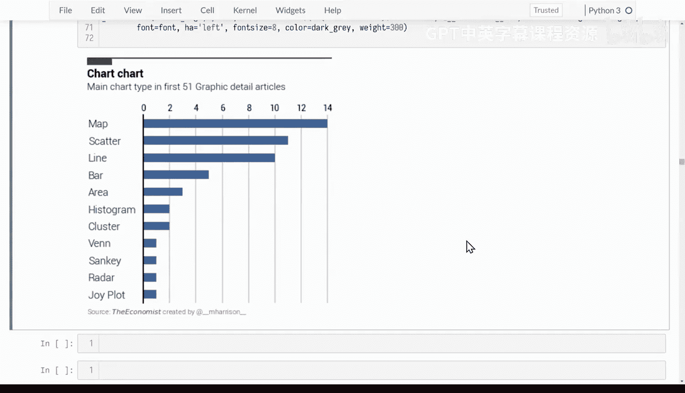

# 杜克大学《应用Python数据工程（3课全）｜Applied Python Data Engineering》中英字幕 p116 17_02_05_使用Pandas创建条形图.zh_en -BV1nz421i7KP_p116-

In this section， where're going to make a bar plot。

 we'll start off with a simple one and then we'll customize it quite a bit。

Here's the bar plot that we want to emulate， this is from the economist， I've got a link there。

 the economist visualization folks made a bar plot of the plots that they made in the economist and。

A bar plot， remember， is a great plot for summarizing counts of categoric data。

 And this is exactly what we see here down the left hand side。 We see categories of plots。

 and the bars represent how many each of those they created。

 We're going to try and recreate this plot the best we can using pandas and mapte plotlib。😊。

Okay here's our data right here， I've just manually created this data。

 I'm going to now call plot and make a bar plot of this and tell what I want in the X axis and what I want in the Y axis at a basic level。

 this is the plot and generally if I'm just doing something for myself， I would probably end here。

 well I'd actually probably end on this next one， a horizontal plot just because I like those labels to be easy to read without tweaking my neck。

Let's try and make this a little bit more like what we see in the example above and theres the output from this so you can see that this now has quite a few more lines we've setting the font at the top we're setting some colors we're making a figure in an access we're making this data frame by sorting the values we're calling bar H2 plot that and then we are setting the Xt locations and the Xt labels and you can see down here that this is going from 0 to 15 by 2 and because Python is the half open interval it doesn't include 15 it actually ends up 14。

Say the labels are going on the top， the labels on the bottom are false。

 we're setting some padding to shift things around。

 we're setting the label size and we're saying get rid of the ticks on the bottom with bottom is equal to fault。

 we're also getting rid of the Y label because we don't need it。

The next thing we're doing is setting the grid， you can see that we're just setting a grid in the X axis and we've got the line width set as well as the color and which grid we have a major and a minor grid in this case we're just setting the major grid there。

You see that the grid only goes in one direction。Next thing we're going to do is set the spines and make them invisible。

 remember the spines or the box that goes around this。

 if you look down here there is no box going around our plot。

The next thing we're going to do is make the left spine thicker。And if you look down here。

 you can actually see the line on the left side， its that black line， it is a little bit thicker。

After that， we're going to move the left spine above the bars we're seeing the Z order to 10。

 and that pushes it above those blue lines。The next code is for making the little red box at the top with the line above that that's using this patch system。

 This is just fiddling around with those numbers to get those boxes to look correct。 After that。

 we're going to set some text in there。 You can see that I'm saying chart chart and I'm setting the font size and the weight of that font and then I'm setting a subtitle below that。

 but I'm just using text to do that。 and then finally at the bottom。

 I'm putting an attribution in there。 mapplotlibb is going to give you the ability to basically draw whatever you want。

 So if you want to make a plot and tweak everything about it you can。

 and hopefully you can see that in this case， we basically replicated that economist look and fill with quite a few more lines of code than our default plot。

