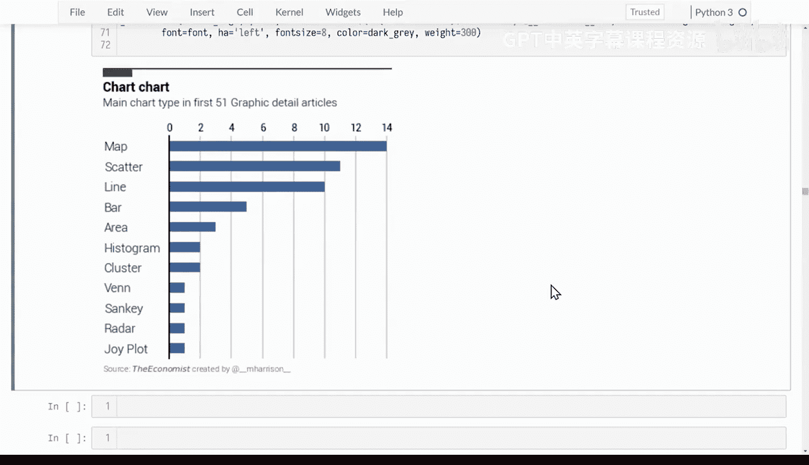

# 数据可视化：第17章：使用Pandas创建条形图 📊


在本节课中，我们将学习如何使用Pandas和Matplotlib创建条形图。我们将从一个简单的条形图开始，然后逐步进行大量自定义，最终目标是模仿《经济学人》杂志风格的一个复杂条形图。条形图是汇总分类数据计数的绝佳工具。

## 概述

本节我们将学习创建条形图的基础知识，并深入探索如何自定义其外观，包括调整颜色、字体、网格、边框（spines）以及添加文本标注，以实现专业出版物的视觉效果。

---

## 创建基础条形图

首先，我们从一个简单的条形图开始。以下是创建基础条形图的步骤。

我们从一个手动创建的数据集开始。调用`plot`方法并指定X轴和Y轴的数据，即可生成基础条形图。

```python
# 假设 df 是我们的DataFrame，包含 'Category' 和 'Count' 两列
df.plot(kind='bar', x='Category', y='Count')
```

对于个人使用，这样的图表可能已经足够。但为了获得更好的可读性，我们通常更喜欢水平条形图，这样类别标签更容易阅读。

```python
df.plot(kind='barh', x='Category', y='Count')
```

---

## 自定义条形图以模仿专业风格

上一节我们介绍了基础条形图。本节中，我们来看看如何通过一系列自定义步骤，使图表更接近《经济学人》杂志的风格。这需要更多的代码，但能显著提升图表的专业外观。

以下是实现高度自定义条形图的关键步骤：

1.  **设置字体与颜色**：在绘图开始时，定义全局字体和颜色方案。
2.  **创建图形与坐标轴**：使用`plt.subplots()`显式创建图形（figure）和坐标轴（axes）对象，以便进行精细控制。
3.  **准备数据**：对数据框进行排序，确保条形顺序符合预期。
4.  **绘制水平条形图**：使用`ax.barh()`方法绘制条形。
5.  **自定义坐标轴刻度**：设置X轴的刻度位置和标签，例如从0到14，步长为2。同时，将刻度标签置于顶部，并隐藏底部标签和Y轴标签。
6.  **添加网格线**：仅在X轴方向添加主要网格线，并设置其线宽和颜色。
7.  **处理边框（Spines）**：隐藏图表四周的边框线（spines），然后将左侧的边框线加粗并置于条形图上方（通过设置`zorder`）。
8.  **添加装饰元素**：使用`patches`（图形块）系统在图表顶部绘制红色方框和线条。
9.  **添加文本**：使用`text`方法在图表中添加主标题、副标题以及数据来源标注。

通过以上步骤，我们虽然使用了比默认绘图多得多的代码行，但成功复制了《经济学人》图表的外观和感觉。Matplotlib提供了几乎无限的自定义能力，允许你调整图表的每一个细节。

---

## 总结



本节课中我们一起学习了如何使用Pandas和Matplotlib创建和自定义条形图。我们从最简单的条形图开始，逐步添加了字体设置、颜色调整、网格线、边框控制以及文本标注等高级功能。关键点在于，Matplotlib提供了底层控制能力，只要你愿意投入代码，就能实现任何你想要的视觉效果。记住，好的可视化不仅是展示数据，更是清晰、美观地传达信息。