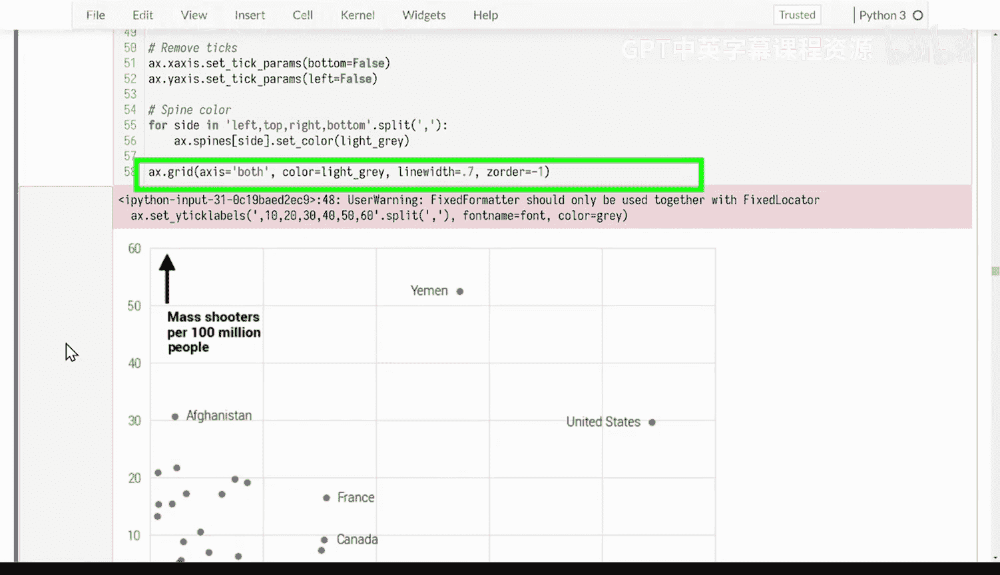

# 杜克大学《应用Python数据工程（3课全）｜Applied Python Data Engineering》中英字幕 p117 18_02_06_使用Pandas创建散点图.zh_en -BV1nz421i7KP_p117-

In this section we're going to look at scatter plots。

 Sc plots allow you to look at the relationship between two numeric values。

 Here's a plot that I want to recreate。 This is from New York Times。

 You can see that this is guns per 100 people against mass shooters per 100 million。

 so we've got countries in there。 and you can see that the United States apparently is not doing great in mass shootings。

 but it also has a lot more guns。So here is the data that I'm going to use。

 I've just hand coded this data， let's load it in here。And let's look at what that looks like。

 you can see that there's a call to clipboard if you want to take this data and put it into your clipboard。

 you can just run that pandas code to do that。Okay here's our basic plot all we have to do is say we're going to do is scatter plot and in the X axis we want to use the guns per 100 people column in the Y axis we want to do the mass shooters per 100 million people that's your basic plot and if you look at this this is basically telling the same story that we had up here。

Let's clean it up though and make it look more like the New York Times。

Let's run this and see what it looks like。Okay， that's looking pretty good。

Let's go over what's going on here。 We're setting some fonts and some colors。

 we're making a figure in an access。 we are plotting using mappllibb。 Then we're doing an annotation。

 we're doing an annotation mass shooters per 100 million people and guns per 100 million people we're also drawing arrows with those annotations So you can see there's the two annotations that we're sticking on there together with the arrows。

 we're removing the Y label and the X label。 you can see that there's no labels on the X and Y axis there。

I've got a few countries that I want to put in， just like the plot above。

 we're just labeling a few of those countries， so I've got those hand pulled out and then I'm going to query my data and use that query to pull out the location of that country and then plot that information on there。

You see， the countries are popping up there。 I have put the United States on a different side。

 as well as Yemen。 They are on the left hand side， rather than on the right hand side。

We're adjusting the tick locations。 We are adjusting the labels。 We are removing the ticks。

 Those are the actual things that stick out on the X axis and the Y axis。

 and then we're setting the spine color to a light gray。 Finally。

 we are saying put a grid on there as well。

In this section， we showed how to make a scatter plot and then we showed using mapplotlib to clean it up and change that look and feel a little bit。

