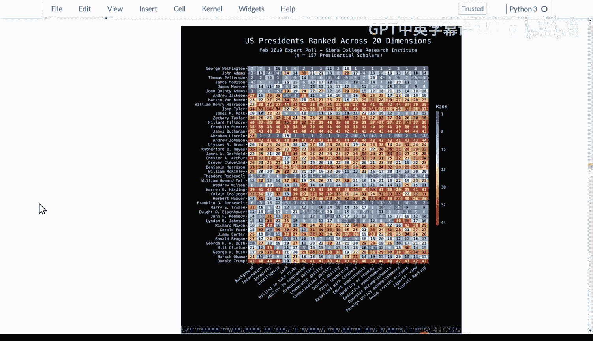
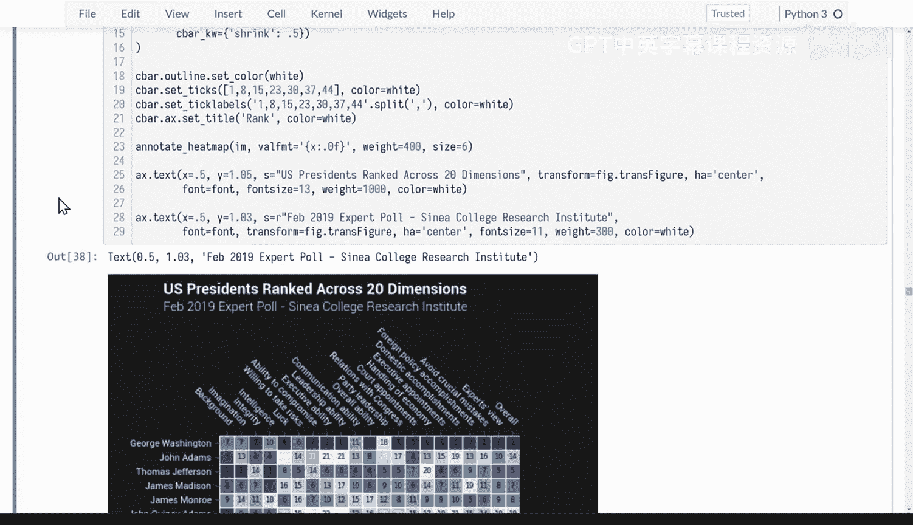

# 杜克大学《应用Python数据工程（3课全）｜Applied Python Data Engineering》中英字幕 p119 20_02_08_使用Pandas创建热力图.zh_en -BV1nz421i7KP_p119-

In this section， we're going to show a heat map。 I like to use a heat map when I'm correlating a bunch of columns。

 You can make a correlation of all the numeric columns to themselves and then color that in a diverging color map to show what has a more positive and a negative correlation。

 In this case， what we're going to do is we're going to recreate a plot that I found on Redddit that my son thought was interesting。

 So this is taken from。😊，The Siena College Research Institute。

 not going to go into like whether the data is good or not。

 but my son found this and I thought it was an interesting plot and so I wanted to try and recreate this using Python here。

So what we've got here is we've got presidents， we've got 20 dimensions that they've been ranked。

 and then blue is a lower rank indicating presumably a better president red is a higher rank indicating worse scores for those dimensions。

Okay let's recreate this so we're going to make sure that we have our libraries loaded and then we're going to load our data。

 I've got this data at my Gitthub here， so I'm going to come down here。

 I'm going to read the data using the read CSV function and then I'm going to throw the results of that into this tweak function up here。

 Let's run that and see if it works。Okay it looks like it worked briefly go over what this tweak Sienena Preez is doing。

 It is saying return this chain， we're going to take the data frame。

 we're going to rename this SeQ period column to SeQ we're going to rename and here we've got what's called it a dictionary comprehension we are looping over this dictionary and we're going to change all these two or three letter。

Shortenened names to long names。 So that's just renaming those columns to their long names。

 And then we've got the call to as type or converting the party column to a categorical column we are also going to pipe the data frame into this function in 64 to U and8 basically all of the data in here is。

Between 0 and 40。 So we don't need to use a 64 B integer to store that。

 We're going to use an 8 B integer that can store up to 256 in it。

 And that's what the int 64 to Uent 8 does。 After that， we're going to make some new columns。

 We're going to make the average rank column， which we are going to take all of the Uent 8 columns。

 We're going to sum that along the column axis。 Then we're going to do a dense ranking method and convert that to a Uent 8。

 We're also going to make a quartile column as well。 to look at the first second and third quartile。

Let's look at the data after we've done this。We have something that looks like this。Okay。

 so how would we plot this。 This is what I would do。

 I would say I'm going to set the index to president。

 I'm going to pull off all the columns from background to overall。

 So I'm skipping that average in and quarile and just pulling off the。

Columns there that have numbers that aren't the last two columns。

 And then I'm going to just look at a data frame。 I'm actually not even going to use map Potlib。

 This is how I would do this thing is you can use the style background gradient with pandas to give you a heat map in pandas itself。

 Now if you want a plot that you can use then we're going to have to do a little bit more work here I'm going to plot this using the mapplotlib。

 I am show plot function and you can see that we get a heat map here。

 but it's a little Spart and it doesn't have any labels or that sort of thing。

 So we're going to have to do a little bit more work。

 Padas in itself doesn't have the ability to plot heat maps。

 It just has the ability to make them in the HTML representation。

 So if I want to make a heat map in map plotlib It's also a little bit more involved as well。

 turns out map plotlib doesn't have heat map functionality either。 So I'm。

Taking this code from the Mapllib website， this is slightly modified。

 but this will allow me to make a heat map and annotate it。 I'm not really going to go over this。

 but I will say that you can use this code to make a heat map generally I would use the seaborn library instead。

 which we'll see later。Okay， and there's the resulting output from this。 looks pretty decent。

 Let's look at what the code is doing。 We are setting some colors。

 We're making a figure in an axis where're saying set the face color to black。

 So the figure by default is white。 We're going to make that figure be black。

 We are making this skills list that has the names of the columns and I'm using some python code to remove the underscores in there。

 and then I'm going to do a chain。 I'm going to take my data frame， set the index present。

 pull off the columns that I want and then pass that into the heat map function with various calls to change the behavior。

 I'm also saying on this color bar。 This is the thing that we see on the right there that says rank above that。

 I'm setting the color of that outline to be white。 You can see as a white outline there。

 you can see that I'm setting the ticks to be white on the color。Bar。

You can see the tech values there， and you can see that I'm also setting a rank。

Title on the color bar。I'm also calling this annotate heat map that puts in the labels inside of the heat map。

 and then I've got a title up at the top and a subtitle just using Maplotlibb text to do that。

In this section， I showed how to make a heat map using mappllib。 again， neither mappllib nor。

Paands gives you heat map functionality out of the box， but with a little searching on the website。

 you can get that， but I generally recommend using seaborn， which I'll show later。

