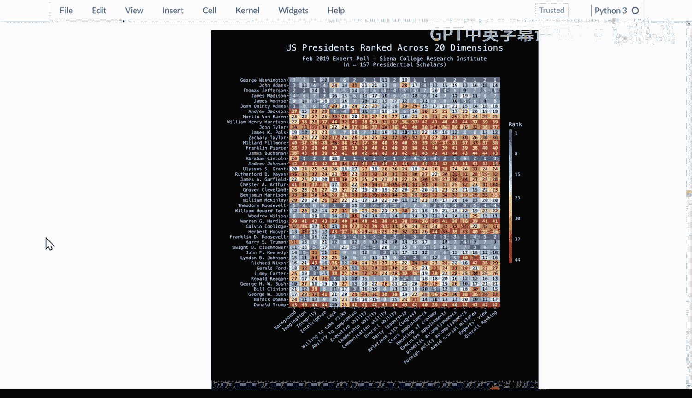
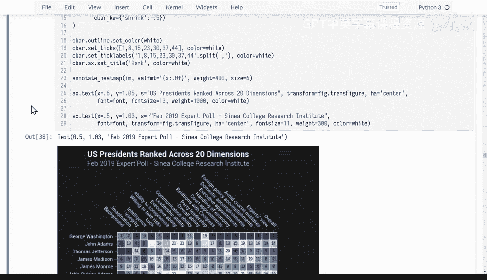

# 应用Python数据工程：3.2：使用Pandas创建热力图 🔥


在本节课程中，我们将学习如何使用Pandas和Matplotlib创建热力图。热力图是一种通过颜色变化来展示数据矩阵中数值大小的可视化方法，特别适用于展示多个变量之间的相关性或比较不同类别的数据。

上一节我们介绍了数据的基本处理，本节中我们来看看如何将处理好的数据以热力图的形式直观呈现。

## 数据准备与处理

首先，我们需要加载必要的库并读取数据。数据来源于Siena College Research Institute关于美国总统的排名数据，包含20个维度的评分。



```python
import pandas as pd
import matplotlib.pyplot as plt
import numpy as np

# 读取数据并应用预处理函数
df = pd.read_csv('president_rankings.csv')
df = tweak_siena_pres(df)
```

以下是`tweak_siena_pres`预处理函数所执行的关键步骤：

*   **重命名列**：将`SeQ.`列重命名为`SeQ`，并使用字典推导式将所有缩写列名替换为完整的名称。
*   **数据类型转换**：将`party`列转换为分类数据类型，并将所有整数列从`int64`转换为更节省内存的`uint8`类型。
*   **创建新列**：计算所有数值列的平均排名，并生成一个表示排名分位数的`quartile`列。

处理后的数据框结构如下，我们主要关注从`background`到`overall`的评分列。

```python
# 设置索引并选择需要绘图的数值列
plot_df = df.set_index('president').iloc[:, :-2]
```

## 在Pandas中生成简易热力图

Pandas的DataFrame有一个便捷的`style.background_gradient`方法，可以直接在Jupyter Notebook等环境中生成HTML格式的热力图。

```python
# 在Pandas中生成带颜色背景的表格（热力图效果）
styled_df = plot_df.style.background_gradient(cmap='coolwarm')
styled_df
```

这种方法快速简便，但生成的是静态HTML表格，无法进行深度定制或轻松保存为高质量的图像文件。

## 使用Matplotlib创建定制化热力图

为了获得可定制且可保存的热力图，我们需要借助Matplotlib。Matplotlib本身没有直接的“heatmap”函数，但我们可以组合其基础功能来实现。

以下是实现热力图的核心代码框架，它定义了绘图、配色和注释的步骤：

```python
def heatmap(data, row_labels, col_labels, ax=None,
            cbar_kw=None, cbarlabel="", **kwargs):
    """
    根据数据矩阵创建热力图。
    """
    if ax is None:
        ax = plt.gca()
    if cbar_kw is None:
        cbar_kw = {}

    # 绘制热力图
    im = ax.imshow(data, **kwargs)

    # 创建颜色条
    cbar = ax.figure.colorbar(im, ax=ax, **cbar_kw)
    cbar.ax.set_ylabel(cbarlabel, rotation=-90, va="bottom")

    # 设置坐标轴刻度
    ax.set_xticks(np.arange(data.shape[1]))
    ax.set_yticks(np.arange(data.shape[0]))
    ax.set_xticklabels(col_labels)
    ax.set_yticklabels(row_labels)

    # 旋转x轴标签并设置对齐方式
    plt.setp(ax.get_xticklabels(), rotation=45, ha="right",
             rotation_mode="anchor")

    return im, cbar

def annotate_heatmap(im, data=None, valfmt="{x:.2f}",
                     textcolors=("black", "white"), threshold=None):
    """
    在热力图的每个单元格中添加文本注释。
    """
    if not isinstance(data, (list, np.ndarray)):
        data = im.get_array()

    # 设置文本颜色的阈值
    if threshold is not None:
        threshold = im.norm(threshold)
    else:
        threshold = im.norm(data.max())/2.

    # 遍历数据矩阵，添加文本
    kw = dict(horizontalalignment="center",
              verticalalignment="center")
    for i in range(data.shape[0]):
        for j in range(data.shape[1]):
            kw.update(color=textcolors[int(im.norm(data[i, j]) > threshold)])
            im.axes.text(j, i, valfmt.format(data[i, j]), **kw)
```

以下是使用上述函数绘制最终热力图的步骤：

1.  **设置图形与颜色**：创建图形，设置背景色，并定义数据矩阵和标签。
2.  **调用热力图函数**：使用自定义的`heatmap`函数绘制基础热力图。
3.  **添加注释**：调用`annotate_heatmap`函数在每个单元格中显示具体数值。
4.  **添加标题与装饰**：为图表和颜色条添加标题，并调整颜色条的样式（如边框颜色、刻度颜色）。

```python
# 准备数据与标签
skills = [col.replace('_', ' ') for col in plot_df.columns]
presidents = plot_df.index

fig, ax = plt.subplots(figsize=(12, 8))
fig.patch.set_facecolor('black')

# 绘制热力图
im, cbar = heatmap(plot_df.values, presidents, skills, ax=ax,
                   cmap="coolwarm", cbarlabel="Rank")
# 为颜色条添加白色边框和标题
cbar.outline.set_edgecolor('white')
cbar.ax.tick_params(colors='white')
cbar.ax.set_ylabel('Rank', color='white')

# 添加数值注释
annotate_heatmap(im, valfmt="{x:.0f}")

# 添加主标题和副标题
ax.set_title("Presidential Leadership Survey", color='white', pad=20, size=16)
ax.text(0.5, 1.05, "Siena College Research Institute (2022)",
        transform=ax.transAxes, ha='center', color='lightgray')

plt.tight_layout()
plt.show()
```



## 总结


本节课中我们一起学习了创建热力图的两种方法。我们首先使用Pandas的`style.background_gradient`快速生成一个交互式的热力图预览。接着，我们深入使用Matplotlib，通过组合`imshow`、颜色条和文本注释等功能，从头构建了一个高度定制化的热力图，并实现了添加数值标签、自定义颜色映射和样式美化。

需要指出的是，Pandas和Matplotlib都没有提供开箱即用的单一热力图函数。对于更复杂或更标准的热力图需求，**Seaborn库**的`sns.heatmap`函数通常是更简单、更强大的选择，这将在后续课程中介绍。本节的手动实现方法有助于理解热力图的构成原理，并提供了最大的灵活性。