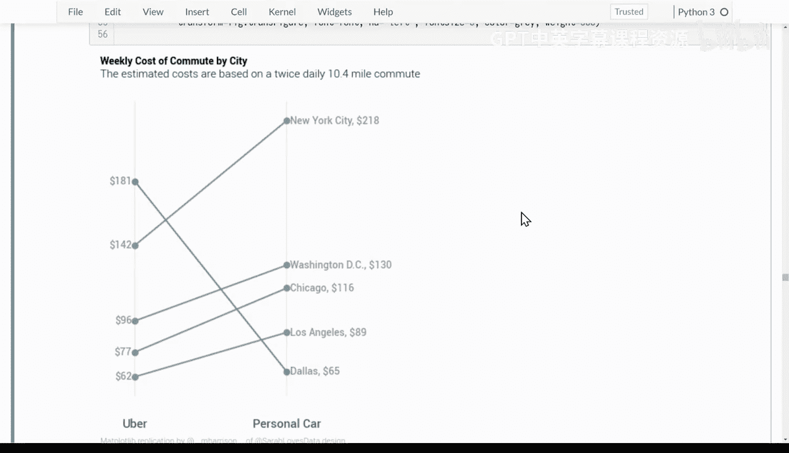

# 杜克大学《应用Python数据工程（3课全）｜Applied Python Data Engineering》中英字幕 p120 21_02_09_使用Pandas创建斜率图.zh_en -BV1nz421i7KP_p120-

In this section， I'm going to show a slope graph， which is not one of the plots I've talked about so far。

 but it's a variation on a plot that I think can be used to tell a good story。

Here is what we want to visualize。 I've taken this plot from the storytelling with data website。

 and you can see that this is saying that it is cheaper to take an Uber than to own a car in four out of five cities。

 so unless you live in Dallas， you should take Uber is basically what this is saying。

Let's see if we can recreate this plot here。We'll load our libraries。 Here's the data。

 I'm just manually creating this data。 And this is how I would do this。 I would say。

 let's set the index to city。So we're going to move City into the index， I'm going to transpose that。

 let me just show you what what happens when I do this。

So here's our original data we're going to set the city to the index here。

 we're going to transpose it that flips the rows in the columns at this point I've got Uber and personal cart in the index and then I've got the cities in the columns if I do a plot of that。

This is going to， for each column， it's going to do a plot。

 so you can see that each of those columns is its own plot。

New York City goes from Uber to personal car， so it's going to put Uber at position zero and personal car at one and do a little line plot for each of those。

So that may be somewhat counterintuitive or non intuitiveitive。

 but that's how we can do one of these slope plots using pandas。Now。

 this is how I would generally do this。 I would just say。

 let's set the index to city and then I would just do a bar plot。

 What that's going to do is it's going to take the index， which is the city。

 put that along the X axis。 And then because we have two columns。

 it's going to put each of those columns above each of those entries there like this。

 This is generally how I would do this。Okay， and this， I think， tells an okay story， but。

You can see that the blue line is higher in Dallas， but your eyes might not be directed to that。

 right？ And so one of the things you want to think about is what story you want to tell。

 And that slope graph tells a story that in Dallas its cheaper to have a personal car。

 but everywhere else。 it is not。 It's not clear from looking at this that this is the story that this is telling。

So let's look at how we would do this at the top here。 I've got my colors in my font。

 I'm going to make my figure。 I'm going to throw my plot on there。

 I'm going to set my X ticks to Uber and personal car。 I'm going to get rid of my Y ticks。

 I'm going to set my tick prams here。 So on the bottom。

 I'm going to not have ticks on the left hand side。 I'm going to not have ticks。

 I'm going to set the spine。To invisible， I say， set visible default faults。

 I'm going to put some vertical lines on there。 and then I'm going to make some labels。

 These labels are going to be on the left and right side。

 Let's plot this so you can see those labels on the left hand side。

 I've got the dollar amount on the right hand side。 I've got the city and the dollar amount。

 And that's created by these two for loops。 The top one is just putting the dollar amount。

 The next for loop is putting the city and the dollar amount on the right hand side。

 We're putting some text on there as well。 So this this is the plot。 Again。

 I think this tells a completely different story。 It has the same data。

 but it tells a different story。 In this section we showed a slope graph。

 A slope graph is not something you see super common， but it can tell a good story。

 especially if you use some of these techniques that we've talked about such as annotation or color muting to pull attention to certain aspects of。

Your data。

