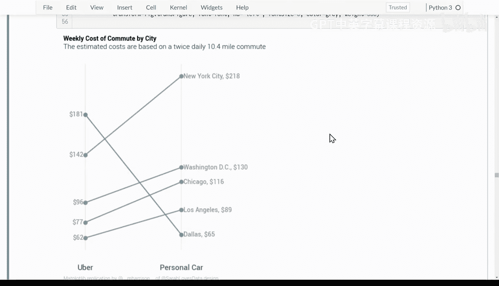

# 应用Python数据工程：3：使用Pandas创建斜率图 📈


在本节中，我们将学习如何创建一种名为“斜率图”的图表。斜率图并非我之前介绍过的标准图表类型，但它是折线图的一种变体，能够有效地讲述数据背后的故事。

## 概述

我们将通过一个具体案例来学习斜率图的创建。该案例比较了在五个不同城市中，使用Uber出行与拥有私家车的成本。我们的目标是复现一个能清晰传达“在五个城市中的四个，使用Uber比拥有私家车更便宜”这一结论的图表。

## 准备数据与基础绘图

首先，我们需要加载必要的库并创建示例数据。

```python
import pandas as pd
import matplotlib.pyplot as plt

# 手动创建数据
data = {
    'city': ['New York', 'Los Angeles', 'Chicago', 'Dallas', 'Washington DC'],
    'Uber': [20, 18, 16, 12, 19],
    'personal car': [25, 22, 20, 10, 23]
}
df = pd.DataFrame(data)
```

为了使用Pandas绘制斜率图，我们需要对数据框进行转置，将城市名作为列，将出行方式（Uber和个人汽车）作为索引。

```python
# 将‘city’列设为索引并转置数据框
df_slope = df.set_index('city').T
print(df_slope)
```

执行上述代码后，数据框的结构将发生变化，此时每一列代表一个城市，每一行代表一种出行方式。直接对这个转置后的数据框调用`.plot()`方法，Pandas会为每一列（即每个城市）绘制一条连接两种出行方式成本值的线段。

```python
# 基础斜率图
df_slope.plot()
plt.show()
```

然而，这种方法绘制的图表可能不够直观。更常见的做法是使用柱状图进行对比。

上一节我们介绍了创建斜率图的数据准备步骤，本节中我们来看看如何通过柱状图进行初步的可视化。

```python
# 使用原始数据框绘制分组柱状图
df.set_index('city').plot(kind='bar')
plt.show()
```

柱状图能够清晰地展示每个城市两种出行方式的成本对比。但是，它可能无法像斜率图那样突出地强调“在大多数城市，Uber成本线低于个人汽车成本线”这一整体趋势，尤其是在数据点较多时。

## 构建增强型斜率图

为了让故事更突出，我们将手动构建一个增强版的斜率图。这个版本会使用颜色、标签和注释来引导观众的视线。

以下是构建该图的核心步骤：

1.  **创建图形与坐标轴**：初始化画布和坐标轴。
2.  **绘制线段**：为每个城市绘制一条从“Uber”点到“个人汽车”点的线段。
3.  **定制坐标轴**：隐藏不必要的边框和刻度，使图表更简洁。
4.  **添加标签与注释**：在图表左右两侧添加城市名称和具体数值，并使用颜色高亮关键信息（例如，达拉斯的情况与其他城市相反）。

```python
# 定义颜色和字体
uber_color = '#1f77b4'
car_color = '#ff7f0e'
highlight_color = 'red'  # 用于突出达拉斯
font_label = {'fontsize': 9, 'ha': 'center', 'va': 'center'}

fig, ax = plt.subplots(figsize=(8, 6))

# 设置X轴刻度位置和标签
x_positions = [0, 1]
x_labels = ['Uber', 'Personal Car']
ax.set_xticks(x_positions)
ax.set_xticklabels(x_labels)

# 隐藏Y轴刻度和 spines（边框）
ax.set_yticks([])
for spine in ['top', 'left', 'right']:
    ax.spines[spine].set_visible(False)
ax.spines['bottom'].set_position('zero')  # 将底部边框放在0位置

# 为每个城市绘制线段和标签
for idx, row in df.iterrows():
    city = row['city']
    uber_val = row['Uber']
    car_val = row['personal car']
    
    # 选择线段颜色：达拉斯用高亮色，其他用灰色
    line_color = highlight_color if city == 'Dallas' else 'lightgray'
    linewidth = 2.5 if city == 'Dallas' else 1
    
    # 绘制连接线
    ax.plot(x_positions, [uber_val, car_val], 
            marker='o', color=line_color, linewidth=linewidth)
    
    # 在左侧添加城市名和Uber成本
    ax.text(x_positions[0]-0.05, uber_val, f'{city}\n${uber_val}', 
            **font_label, ha='right')
    # 在右侧添加个人汽车成本
    ax.text(x_positions[1]+0.05, car_val, f'${car_val}', 
            **font_label, ha='left')

# 添加标题
ax.set_title('Cost Comparison: Uber vs Personal Car (per week)', pad=20)

plt.tight_layout()
plt.show()
```

通过上述代码，我们创建了一个信息丰富且重点突出的斜率图。观众的视线会被引导至达拉斯那条颜色不同的线段，从而立刻理解“除了达拉斯，其他城市使用Uber更便宜”的核心结论。

## 总结




本节课中我们一起学习了斜率图的创建与应用。我们首先了解了斜率图是一种用于比较两个时间点或状态间数据变化的有效工具。然后，我们通过Pandas的基础绘图功能和手动增强两种方式实现了斜率图。关键点在于，通过精心的设计（如数据转置、颜色高亮、添加直接标签和去除图表噪音），我们可以让同一个数据集讲述一个更清晰、更有力的故事。斜率图虽不常见，但在需要强调数据点之间变化和对比的场景下，它是一个非常强大的选择。