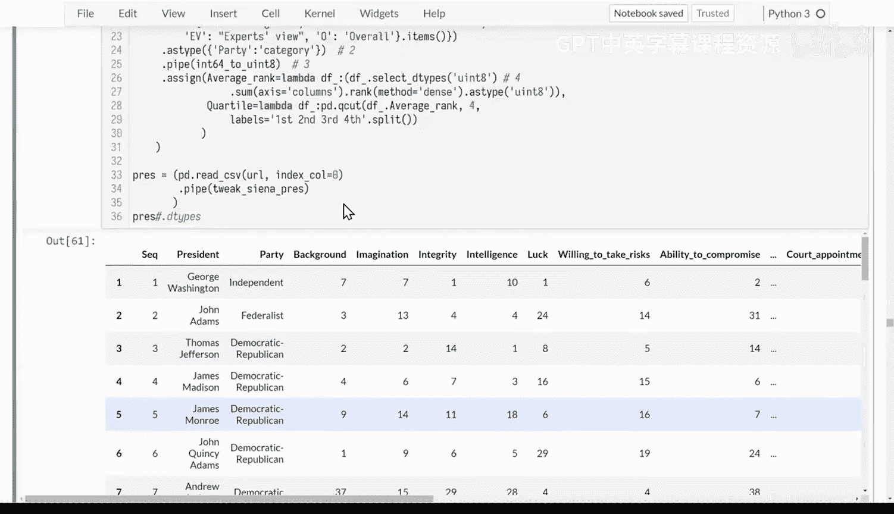

# 杜克大学《应用Python数据工程（3课全）｜Applied Python Data Engineering》中英字幕 p121 22_02_10_Pandas方法链式调用.zh_en -BV1nz421i7KP_p121-

In this section， I'm going to talk about chaining and pandas Now。

 we've seen this in the videos that we've looked at so far。

 What I mean when I say chaining and pandas is that I take an operation。

 that I do an operation after that， then I do an operation after that。

 You might think that's a little bit complex。 or how do I do that。 Now。

 I'm showing you the end result here。 But when I created these。

 I didn't just type out the whole chain and run it。 When I create these。

 I'm debugging them along the way。 So I'm going show one of the more complicated chains that I have。

 which is just pandas code， But I'm going to show you actually how I would create it by commenting out the code in there and then walking you through what's going on。

 My take， and I've seen this from hundreds of people who have read my book or taken my courses。

 is that if you start coding your pandas code this way as a chain。

 it will force you to think about the logical steps you need to take on each operation。

 it will also make your code look like a recipe。First do this， then do this， then do this。

Do you have to use chaining， No you don't， but my recommendation for you is to try it out。

 My experience is that most people who try it out say that it changes the way that their code looks and for the better。

 So let's look at this。Okay， this is the presidential data here。

 and you can see that I've got a pretty big chain here。 So at the bottom here， I am reading the data。

 and then I'm just calling pipe to pipe everything into this tweak function。

 I like to make a tweak function and just have that function， do all the cleanup for me。

 then when I need to load my data again， I don't need to run multiple cells is just all in one place and I can do that。

 however， let's like debug this and see what happens or how I might build this up。

 So what I might do is I might comment out everything in here。Okay， I've got this all commented out。

 and basically what I'm going to do is I'm going to say read the data from the URL。

And then just return the data。 So this should just be the data from the URL。

 I'm printing it out at the bottom here。 So this is， this is my original data at the bottom。Okay。

And so I need to think， what do I want to do with this data。 Well， if you look at this。

 I've got this seek entry here and it's got a period in that。

 So maybe I want to get rid of the period。 So let's try and get rid of the period。

 And this is how I do that。 I'm gonna say rename columns seek and then just get rid of that period。

 Let's run that again and you can see that the period goes away。 Okay。

 what's the next thing I want to do。 I've got all these columns here that are like Bg。

 and I want to like change those into human readable things。

 So I'm going to use rename to do that as well。And here I'm going to use what's called a dictionary comprehension to do that。

 So I'm looping over all these entries here。 I'm just going to do two of them right now。

 I'm going to do B， G background and E V expert views。 Let's just see if that works。

 And this is how I would do it。 I would try one。 and then I would build it up as I'm going along。

 You can see that the background works。 The experts views work。

 And so then I would come in here and I would do all these other ones。Okay。

 let's run that again and just make sure that it works。 A。 It looks like it's working。 Okay。

 the next thing I want to do is convert party to a categorical。 Now。

 I can come down here and say D types and look at the D types here。

 And I can see that party is an object right now。 It is not a categorical。

 and an object is a string type categorical allows me to save a little bit of memory and do some other operations a lot quicker。

 So all I have to do is say as type party categorical。 I run this again。

 And you can see that party changes to category down here。😊。

Next thing I want to do is change these other ones， which are in 64s to U and8s。

 I have this little code up here that says， just select anything that says in 64 and。

For each of those columns that are in 64s， replace them with UNent8s so I'm going to call pipe and I'm going to pass the current state of my data frame into that function to do that。

 Let's look at here's what we have right now。 Let's run this with that uncommented。

 You can see that these all change to UNent8s。Okay， what's the next thing I want to do。

 I want to add some new columns here。 So I'm going to get rid of this D types down here。

 We want to say like， let's get the average rank。 So let's do that。 How would I get the average rank。

 I would say， I want to take my current data frame。

 Select anything that's a U and 8 summit along access 1。

 You could also say access is equal to columns here。

 And then we're going to say the rank method is dense and convert that to a U and 8。

 Let's just try that out。 And it says that。No access named columns。 I've got a typo。

 Let's fix that typo。And try again。Okay， that that looked like it might work。

 Let's just validate that。 This is one of things I do as I validate as I'm going。

 And here you can see the average rank looks like it did indeed work。Okay， let's do the next one。

 Let's add a quartile here， so I would just stick that into my assign and run that again。

And it gave me a result。 Let's just validate it。 Okay， and quartile worked as well。

In this section， I showed you how I would build up these chains as I'm creating my pandas code。

 Padas is super powerful。 I'm highly biased， but this is the way that I like to work with data。

 I like to use Python to fetch my data and manipulate it。

 and pandas is the language or API that we use in Python to manipulate data。

 If you understand how to manipulate data with pandas。

 It's going to allow you to do a lot of really cool things。

 I highly recommend you trout this chaining style。 I think you're going to be happy with it once you start understanding how to leverage it。

