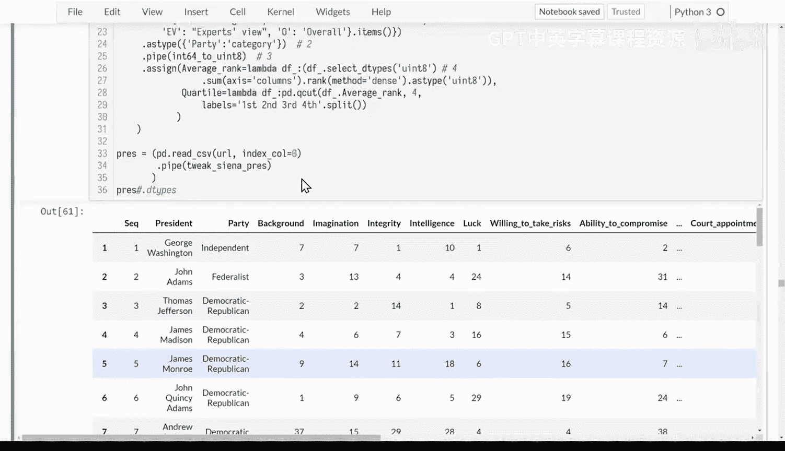

# 应用Python数据工程：3：Pandas方法链式调用 🐼


在本节中，我们将学习Pandas中的方法链式调用。这是一种将多个操作按顺序连接起来的编程风格，可以使代码更清晰、更易于理解。

## 概述

方法链式调用允许我们在一行代码中连续执行多个Pandas操作。这种方式不仅使代码看起来像一份清晰的“食谱”，还能帮助我们更逻辑地思考每一步数据处理。

## 构建方法链

上一节我们介绍了Pandas的基本操作，本节中我们来看看如何通过链式调用将这些操作串联起来。

首先，我们从一个简单的数据读取开始。以下是读取数据并展示原始状态的代码：

```python
df = pd.read_csv('data_url')
print(df)
```

## 逐步构建链式操作

以下是构建链式调用的关键步骤，我们将逐一讲解。

### 1. 重命名列

我们首先处理列名中的多余字符。例如，移除“seek”列名中的句点：

```python
df = df.rename(columns={'seek.': 'seek'})
```

### 2. 使用字典推导式重命名

接下来，我们将使用字典推导式将缩写列名转换为更易读的名称：

```python
rename_dict = {col: full_name for col, full_name in column_mapping.items()}
df = df.rename(columns=rename_dict)
```

### 3. 转换数据类型

为了优化内存和性能，我们将“party”列转换为分类类型：

```python
df['party'] = df['party'].astype('category')
```

### 4. 优化数值类型

我们还将把int64类型的列转换为更节省空间的uint8类型：

```python
int64_cols = df.select_dtypes(include=['int64']).columns
df[int64_cols] = df[int64_cols].astype('uint8')
```

### 5. 添加新列

最后，我们添加一些计算列，例如平均排名和四分位数：

```python
df['average_rank'] = df.select_dtypes(include=['uint8']).mean(axis=1).rank(method='dense').astype('uint8')
df['quartile'] = pd.qcut(df['average_rank'], 4, labels=False)
```

## 完整链式调用示例



将以上步骤组合起来，我们就得到了一个完整的方法链：

```python
df = (pd.read_csv('data_url')
      .rename(columns={'seek.': 'seek'})
      .rename(columns=rename_dict)
      .assign(party=lambda d: d['party'].astype('category'))
      .pipe(lambda d: d.astype({col: 'uint8' for col in d.select_dtypes(include=['int64']).columns}))
      .assign(average_rank=lambda d: d.select_dtypes(include=['uint8']).mean(axis=1).rank(method='dense').astype('uint8'),
              quartile=lambda d: pd.qcut(d['average_rank'], 4, labels=False)))
```

## 总结

本节课中我们一起学习了Pandas方法链式调用的核心概念和构建步骤。通过将多个操作连接成一条链，我们可以使代码更加简洁和逻辑清晰。虽然链式调用不是必须的，但尝试使用它可能会改变你编写数据处理代码的方式，并带来更好的可读性和维护性。Pandas是一个强大的工具，掌握其链式调用技巧将帮助你在数据工程中完成更多有趣的任务。