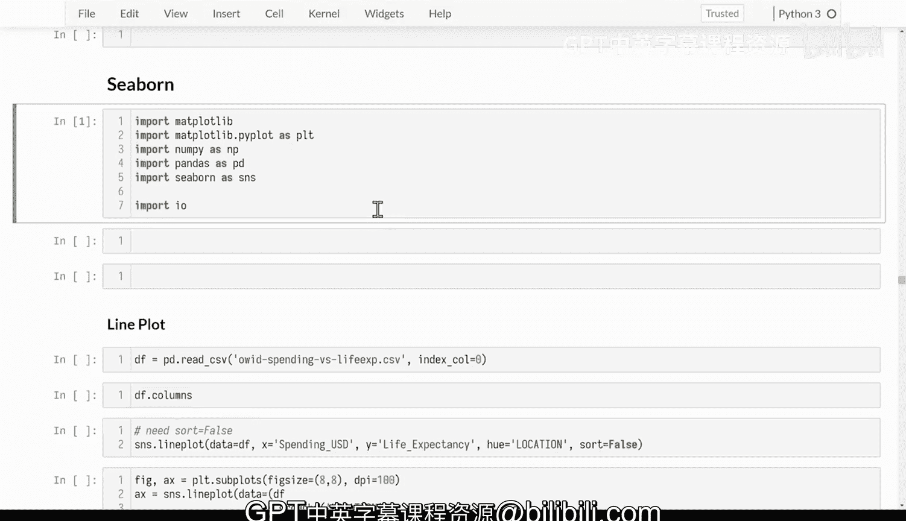

# 杜克大学《应用Python数据工程（3课全）｜Applied Python Data Engineering》中英字幕 p122 23_02_02_Seaborn库简介.zh_en -BV1nz421i7KP_p122-

Let's talk about the Seaborn Library。 The Seabornour library is a nice library that it builds on top of both mapplotlibb and Pada。

 So it gives you some convenience functions for making plots that would be a little bit more difficult to do otherwise。

 Again， you can go to the Seaborn website and check out their tutorial documentation。

 It tends to be quite good。 What we're going do in this example is I'm going to recreate the plots that I did using mapplotlibb with Seaborn and you'll see that basically because it's built on top of that。

 it's relatively easy to do， but we'll also see that some of these plots are actually easier in Seaborn because Seabornour already provides an interface for doing some of the things we want to do。

So one of the things that we need to do is we need to load the Seabornoure Library。

 generally that's alias as SNS， just a side that stands for Samuel Norman Seabornour。

 apparently in the West Wing there was a character named Seabornour and this library is named after that。

