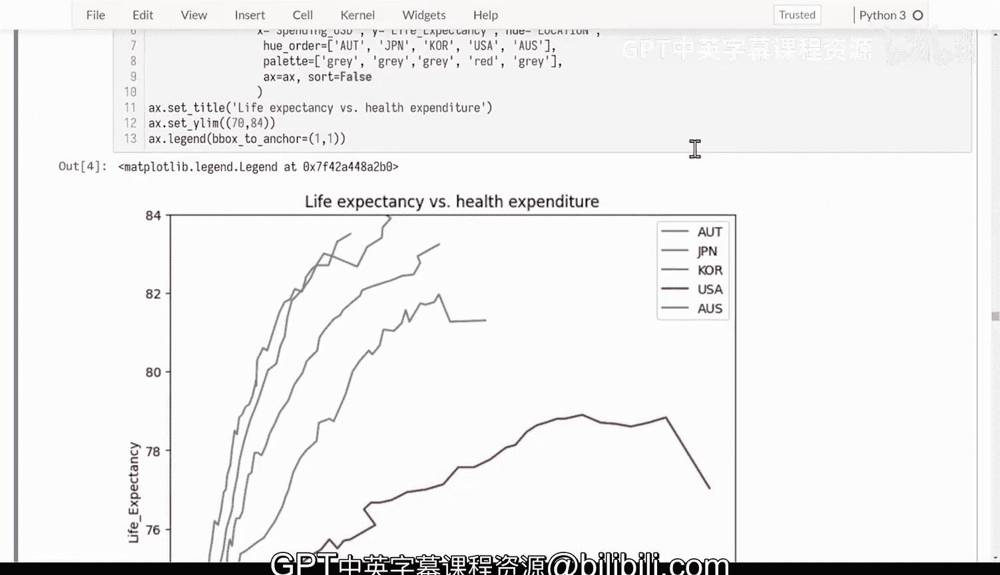

# 杜克大学《应用Python数据工程（3课全）｜Applied Python Data Engineering》中英字幕 p123 24_02_03_使用Seaborn创建折线图.zh_en -BV1nz421i7KP_p123-

In this video， we're going to look at making a line plot。

 we're going to recreate our spending line plot with seaborn。Let's load the data。

And let's do a line plot。There we go。 with one line of code。 we have the line plot。

 says the world's greatest plot。 No， not necessarily， but you can see that。Seeaborn allows us to say。

 for example， location and split that data out without having to do any grouping。

 And if we say sort is equal to faults， we get to the lines that can go back on themselves。

 Let's see if we can clean it up and make it look a little bit better。Okay， so that's looking， okay。

 let's dive into what's going on here。 This is not a complete recreation of what happened above。

 But if you look at this， you can see that this is built on top of that Plet。 If we wanted to。

 we could go in there and we could tweak this and make it look exactly like the one above。

 Let me just talk about what's going on here。 We're doing a little bit of filtering。

 Now we're also specifying this Hue order， which limits the countries that we're looking at。

 we're also specifying the pette。 that's an aligned list that has the same order as that hue order。

 you can see that we specified that the US is red。 Then we've set the title and we've set the Y limit。

You can see that we could further customize this if we wanted to。

 but at this point is doing a pretty good job。

