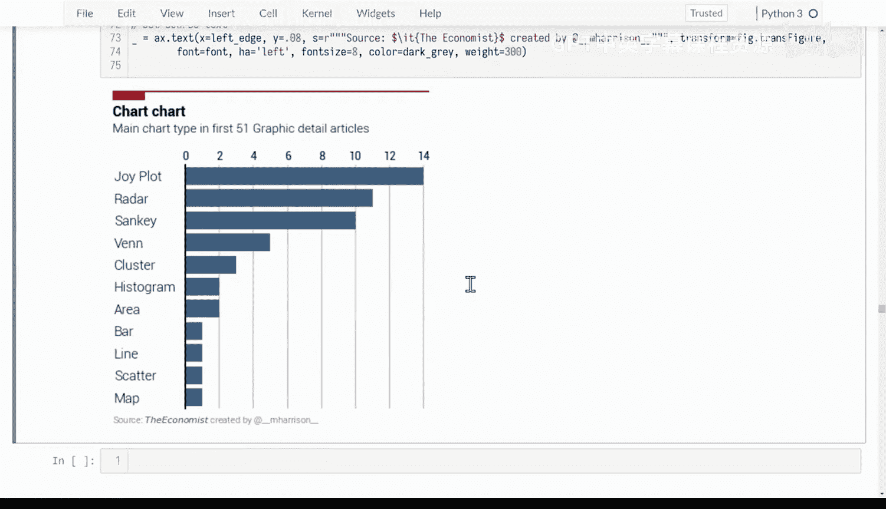

# 杜克大学《应用Python数据工程（3课全）｜Applied Python Data Engineering》中英字幕 p124 25_02_04_使用Seaborn创建条形图.zh_en -BV1nz421i7KP_p124-

In this next section， we're going to look at making a bar plot with the Seaborn Library。

OkayWe're going use the economist data to make the economist barpl。 Here's the data。

 Let's make a countpl。 That's what Seaborn calls a barpl。 And if we look at this。

 it's not really what we want。 That's because if we look at our data。

 we only have one entry for each type。 And basically this count plot is going through this data and saying。

 yeah， you only have one entry of each type。 What we really need if we want to leverage this is what real worldord data would look like where you would have a column and you would have categorical entries that would repeat in that column。

 So I'm going simulate that with this econ DF2 data frame。

 I'm just going to say that there are 14 entries for map。 It's 11 for scatter plot， etc。

 And if we throw this into count plot， we get what we want。

 let me just show you what that data looks like。You can see that it has all of those counts in there。

Okay， I would probably make a horizontal plot with that。

 One thing that that does is it eliminates like the overlapping。Labels that you see up above。 Now。

 if we want to， we can make this look exactly like the economist version。

 You can see that this is an axy subplot， meaning this is a matte plotlib object。

 So here what I'm going to do is I'm going to throw this into our code that we had above。

 You can see that I've commented out the old code， replaced it with the seaborn code。

 I also added the set X label to a blank string here。 And if we look at the result of this。

 it's exactly what we had above。 Again， this is because seaborn is built on top of matteplotlib。

In this example， we looked at making a bar plot with seaborn。

 and we also showed that seaborn is built on top of Mapllootlibb。

 if you know how to customize a Mapllootlib， you can leverage that knowledge in Cborn。

