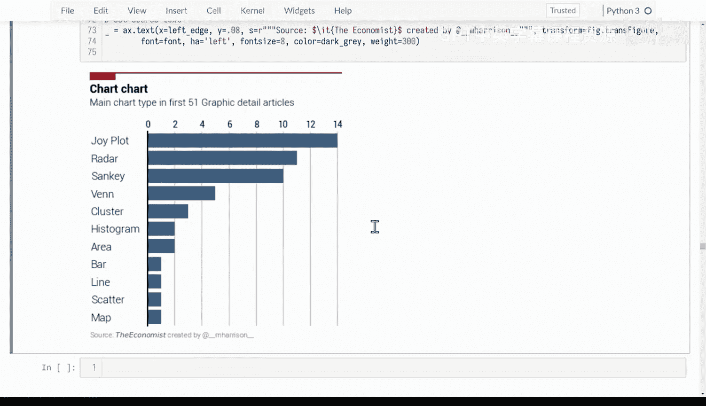

# 应用Python数据工程：3.2.4：使用Seaborn创建条形图 📊

在本节中，我们将学习如何使用Seaborn库来创建条形图。我们将使用一份经济学人风格的数据作为示例，演示如何从基础数据开始，逐步创建并定制一个条形图。通过本节的学习，你将掌握使用Seaborn的`countplot`函数以及如何结合Matplotlib进行深度定制。


---

## 概述

我们将使用Seaborn库来创建一个条形图。Seaborn是建立在Matplotlib之上的一个高级可视化库，它提供了更简洁的API和更美观的默认样式。我们将从一个简单的数据集开始，展示如何创建基础的条形图，并解决实际数据中可能遇到的问题，例如类别计数。最后，我们会将Seaborn的图表与纯Matplotlib的图表进行对比，展示其兼容性与定制能力。

---

## 创建基础条形图

首先，我们尝试使用Seaborn的`countplot`函数来为我们的数据创建条形图。`countplot`本质上就是Seaborn中用于绘制条形图的函数，它会自动计算每个类别的出现次数。

```python
import seaborn as sns
import matplotlib.pyplot as plt

# 假设我们有一个包含图表类型的数据集
data = ['map', 'scatter', 'line', 'bar']
sns.countplot(x=data)
plt.show()
```

然而，运行上述代码可能无法得到我们期望的图表。这是因为我们的示例数据中，每个类别只出现了一次。`countplot`会忠实地统计每个唯一值的数量，所以每个条形的高度都是1。

---

## 处理真实世界数据

在真实场景中，数据通常包含重复的类别条目。为了模拟这种情况，我们需要创建一个包含重复项的数据集。

以下是模拟数据的示例：

```python
import pandas as pd

# 创建一个模拟数据集，其中包含重复的类别
data = {
    'chart_type': ['map']*14 + ['scatter']*11 + ['line']*9 + ['bar']*7
}
econ_df2 = pd.DataFrame(data)
```

现在，如果我们对这个新的数据框使用`countplot`，就能得到正确的、反映每个类别总数的条形图。

```python
sns.countplot(data=econ_df2, x='chart_type')
plt.show()
```

---

## 优化图表显示

默认的垂直条形图在类别标签较长时可能会产生重叠。为了解决这个问题，我们可以将条形图转换为水平方向。

以下是创建水平条形图的代码：

```python
sns.countplot(data=econ_df2, y='chart_type')
plt.show()
```

水平条形图能更清晰地展示类别标签，避免重叠问题。

---

## 结合Matplotlib进行深度定制

由于Seaborn是构建在Matplotlib之上的，我们可以无缝地使用Matplotlib的函数来进一步定制图表。例如，我们可以调整坐标轴标签、标题和样式，使其与特定的出版风格（如《经济学人》）保持一致。

以下是一个结合了Seaborn绘图和Matplotlib定制的完整示例：

```python
# 使用Seaborn创建基础图表
ax = sns.countplot(data=econ_df2, x='chart_type')

# 使用Matplotlib进行深度定制
ax.set_xlabel('')  # 将X轴标签设为空字符串
ax.set_title('Chart Type Distribution', fontsize=14)



# 显示图表
plt.tight_layout()
plt.show()
```

通过这种方式，我们既利用了Seaborn快速绘图的能力，又保留了Matplotlib强大的定制灵活性。最终得到的图表在外观上可以与之前用纯Matplotlib创建的图表完全一致。

---

## 总结

在本节中，我们一起学习了如何使用Seaborn库创建条形图。我们从基础的`countplot`函数开始，理解了它如何处理数据。接着，我们模拟了包含重复类别的真实数据，以生成有意义的图表。然后，我们通过将条形图改为水平方向来优化其可读性。最后，我们展示了如何利用Seaborn与Matplotlib的兼容性，对图表进行深度定制，以满足特定的视觉风格要求。掌握这些技能后，你将能够高效地创建既美观又实用的数据可视化图表。