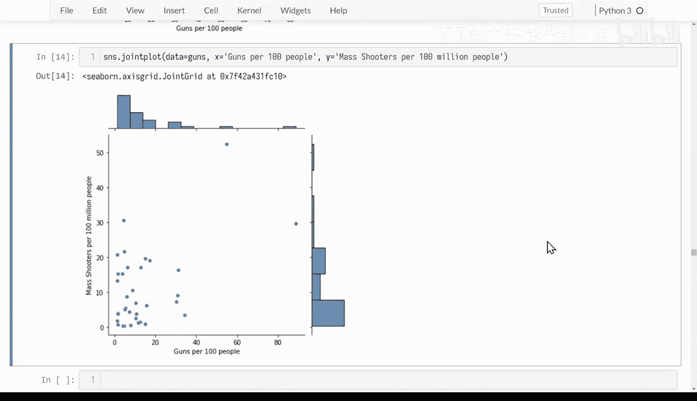

# 杜克大学《应用Python数据工程（3课全）｜Applied Python Data Engineering》中英字幕 p125 26_02_05_使用Seaborn创建散点图.zh_en -BV1nz421i7KP_p125-

In this example， we're going to look at making a scatter plot using the Seaborn library。

We're going to use our gun data and let's make a plot here here we're going to use what's called LM plot and you can see with one line of code I have this plot here。

 let's pull the documentation for LM plot， you can see that this will plot data。

 but it also plots a regression model there are a bunch of options in here。

 but you can see that with one line of code not only do we have a scatter plot。

 but we have a regression model。Let's look at another way to make a scatter plot in seaborn。

 I're going to do a joint plot。 This is another plot that you could do in mapplot lab or pans。

 but it would be kind of a pain in its' one line of code Here。

 We don't just have the scatter plot along the axes。

 We have histograms giving us an insight into the distribution of that data。Now。

 these aren't telling the same story that our plots were telling up above。

 but I think they are great plots and they're great examples showing the power of seaborn。

