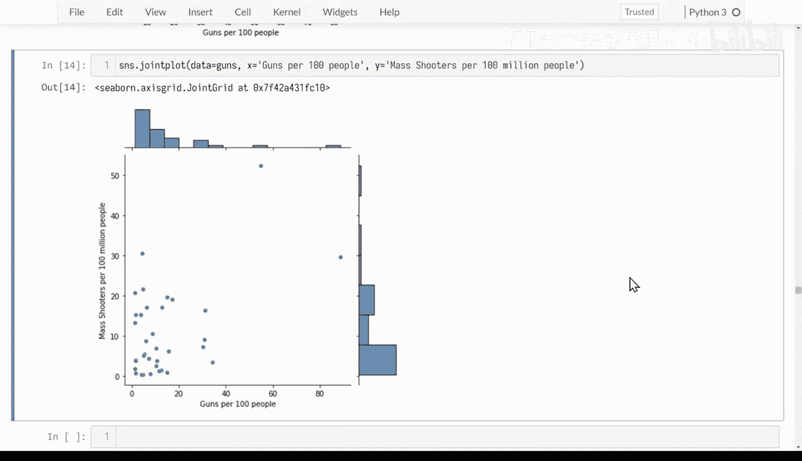

# 应用Python数据工程：3：使用Seaborn创建散点图


在本节课中，我们将学习如何使用Seaborn库创建两种强大的散点图：`lmplot`和`jointplot`。我们将使用枪支数据作为示例，演示如何通过极简的代码生成不仅包含数据点，还包含回归模型和数据分布信息的可视化图表。

## 使用 lmplot 创建带回归线的散点图

上一节我们介绍了Seaborn的基础。本节中我们来看看如何使用`lmplot`函数快速创建散点图并拟合回归模型。

`lmplot`是Seaborn中一个用于绘制数据并拟合回归模型的函数。其核心功能可以用以下代码描述：
```python
sns.lmplot(x='x_column', y='y_column', data=df)
```

通过一行代码，我们不仅得到了数据的散点分布图，还获得了一条直观的线性回归线，帮助我们理解两个变量之间的趋势关系。

## 使用 jointplot 创建联合分布图

了解了带回归线的散点图后，我们来看看另一种更丰富的可视化方式——联合分布图。

`jointplot`可以创建散点图，并同时在坐标轴边缘添加直方图。以下是其基本调用方式：
```python
sns.jointplot(x='x_column', y='y_column', data=df)
```

通过一行代码，我们得到了一个复合图表。主图是变量间的散点关系，而顶部和右侧的直方图则分别展示了每个变量的数据分布情况。这种图在Matplotlib或Pandas中实现起来较为繁琐，但Seaborn使其变得非常简单。

## 总结



本节课中我们一起学习了Seaborn库中两个用于创建散点图的高级函数。我们使用`lmplot`快速绘制了带线性回归模型的散点图，并使用`jointplot`生成了同时展示变量关系和各自分布的联合图。这些例子充分展示了Seaborn在简化复杂数据可视化、提升绘图效率方面的强大能力。