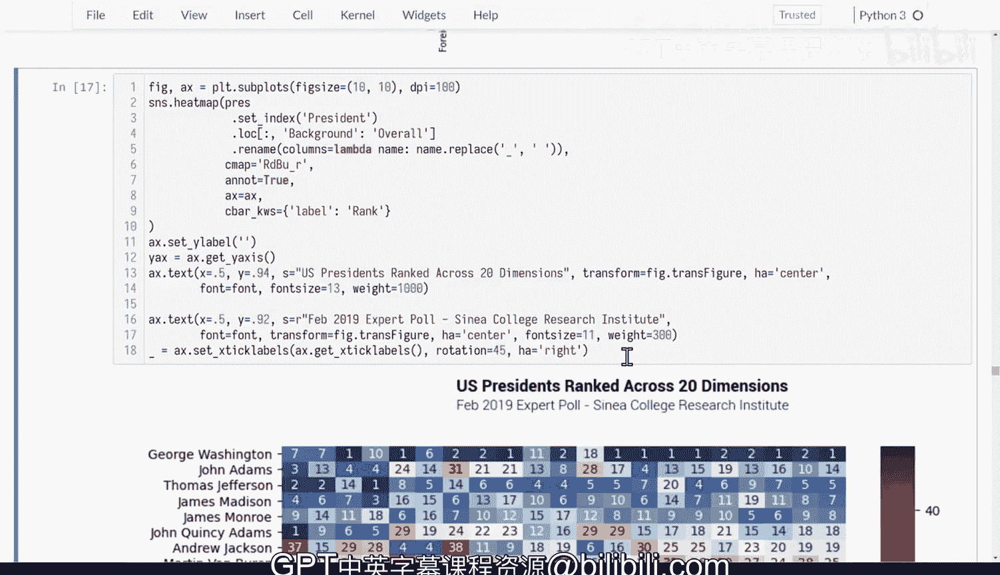

# 杜克大学《应用Python数据工程（3课全）｜Applied Python Data Engineering》中英字幕 p126 27_02_06_使用Seaborn创建热力图.zh_en -BV1nz421i7KP_p126-

In this example， we're going to look at making a heat map with seaborn heat map is one of those built ins that's really nice in seaborn。

 Saly， it is not in pandas， nor is it in mappllib。 So it makes it really easy to do in seaborn。

 whereas it's a little bit more involved in those other tools。Let's load our presidential data。

And here we go， one line of code to make a heat map。There we go。 Now again。

 the result of this is a map plotlib subplot so you can do whatever you want with this。

And let's clean it up a little bit more here Here。 I'm going to say change the color map to this red blue R。

 that means in a reverse order。 I'm going to say annot is equal to true。

 that adds annotations in there。 I'm going to add a label to the color bar。

 and I'm going to clear out the Y label and set some text as well。There we go。There is our plot。

 Again， this is not exactly what we had before。 We're not using the black background。

 but I think this is a great plot。 And it's very few lines of code to do this。 In fact。

 we could get by with mostly just the call to heat map and have a pretty good plot。

 I do like the title on that。 And I think that this is super useful。

