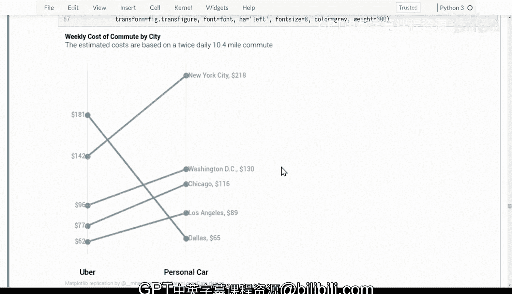

# 杜克大学《应用Python数据工程（3课全）｜Applied Python Data Engineering》中英字幕 p127 28_02_07_使用Seaborn创建斜率图.zh_en -BV1nz421i7KP_p127-

In this next example， we're going to look at making a slope graph。

 Slo graph is not something that's really built into seaborn。

 but we're going to see how we can create when using seaborn。

 let's look at our Uber data and let's try and do what's called a point plot。

 If we make a point plot in there。 it looks like we're not really getting what we want。

 Let's look at our data and our data has city Uber and personal car in order to use point plot。

 we really have to reat the data here。 and we're going to use this melt functionality of pandas to do that。

 So you can see our original data frame up above。 We're going to say melt I vs is equal to city。

 What that's going to do is it's going to say for the other columns that aren't city。

 We're going to pull each of the column names into a column called variable。

 and each of the values for those will go into a column called value once we have the data melted like this。

 we can actually use point plot here。 What I'm going to do is I'm going to say point plot in the x axis。

 I want to use variable。 You can see that that's either Uber or personal car and in y axis we're。

Do value there。 Now， the key here is that I can say Hugh is equal to city。

 And what that's going to do is it's going to take every city that is the same and just do those plots there。

 Watch what happens when I run this code。 you can see that each of these colors or Hughs is a different city。

 and you can see that the purple one is Dallas going in the opposite direction of the other ones。

 Let's see if we can make this look a little bit more like we had before。 In fact。

 because this is built on that plotlib relatively easy to do that。

 You can see I'm commenting out the old code I've had sticking in my new code。

 I've also added a few more lines here because I need to get rid of the legend and clear out some labels that Seaborn inserts for me。

And there we go。 there's our plot。 looks exactly like our other one because it is built on top of that plotlib。

