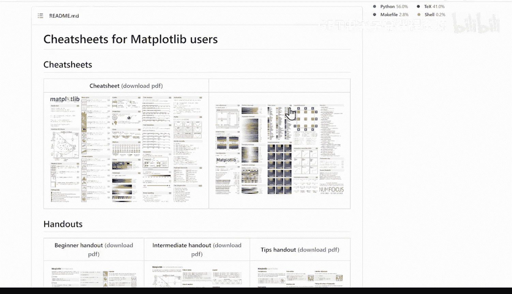

# 杜克大学《应用Python数据工程（3课全）｜Applied Python Data Engineering》中英字幕 p128 29_02_02_Python中Matplotlib简介.zh_en -BV1nz421i7KP_p128-

In this section， we're going to look at customizing mapplotlib。

So one of the things that you should know about Mapllootlibb is that you can customize almost anything。

 I'm going to point to some cheat sheets here， so I recommend that you go to these。

Here are a bunch of cheat sheets that are very useful。 in particular。

 This one here is the color map cheat sheet。 We'll see later on when you want to change color maps。

 you might want to have this reference of what colors to use and those cheat sheets come in useful there。

 In general， the map plotlib documentation is really good。 So I recommend if you have a question。

 check out the documentation on the website， oftentimes there will be examples。

 and oftentimes you can take those examples， Thr them directly into Jupyter and try them out。

