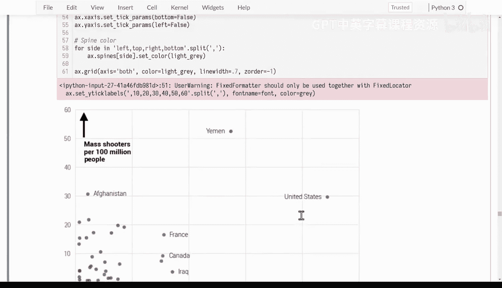

# 杜克大学《应用Python数据工程（3课全）｜Applied Python Data Engineering》中英字幕 p129 30_02_03_Matplotlib文本定制.zh_en -BV1nz421i7KP_p129-

In this section， we're going to look at customizing text and understand what goes on when we customize text with map Ptlet。

So I'm going to look at our gun data again， let's just run that。Again。

 the mapplotlib documentation tends to be pretty good。

 If you look at this text link that I put in here， you can see here are the basic commands。

 and it's got examples for all these and showing how to use them。 So again。

 generally if you have a question about how to do this， go to the mapplotlibb website。

 you can take this code， you can copy it。 you can throw it into your Jupyter and run it and try it out。

Let's look at an example of manipulating the text。 Let's dive into what's going on with that gun data a little bit more。

So here's our plot down here。 and the first thing I want to look at are the bolded text with the arrows。

 that's done with this call to annotate here。 Now， you can see that the first entry there。

 the first parameter to annotate is the actual text。 and then I've got X， Y and X Y text。 So X。

 Y is the location of the arrow X Y text is the location of the text。If you look at these。

 these are both tuples and they're measured in fractions of the axis。 What does that mean。

 fractionacts of the axis。 Well， you could imagine that you have 0% of the axis and 100% is at the other edge。

0% is at one edge。 Also in the vertical。 You could imagine that as well。

 And that's exactly what's going on here。 So again， X Y is where the label is pointing。

 It says point0，3， So 3% over from the left and 100% up。 How do I know that's infrions。 I know that。

 because we have this transform is a X trans axis， And you can see that this label is 3% over and 100% up。

 What about the。Location of the text。 It is 3% over and 70% up。 And I know that because it says X。

 Y chords is equal to the string access fraction。 I wish those were both same strings。

 Not one is this A X trans axis。 and the other one is a string， but it is what it is in。

Maap plototlib。 Now we've got further formatting here。 We have H A is equal to left。

 That means horizontal aligned line is equal to left。

 You can see that it is left aligned 30% over rather than center or right aligned there。

 You can also see that we've set the font size。 We've set the weight to make it bold。

 And we've also have this thing called arrow props。

 which is the dictionary which controls the behavior of that arrow， what that arrow looks like。

 not going to jump into those， but again， you can check out the map plottlib documentation to customized arrows。

 if you want to。 down below that。 We've got another annotation guns per 100 people。 We've got X Y。

 This is also in terms of axes percentage。 and you can see that we have Xy text。

 which is also in terms of axes percentage。 You can see that we've got the transform parameter and the Xy coordinates parameter both specifying that it is a percentage。

And there we go。 interesting thing about the second entry is if you look at the vertical alignment here。

 it says that the vertical alignment is centered so you can see that the arrow is centered vertically with the guns per 100 people。

 Let's look at the other text locations that we have on this， we're removing the X and Y label here。

 we're looping over the countries and we're adding the countries with Ax text now there's an if statement if we're in the United States are Yemen。

 we are going to put these to the left and we're going to right aligned them if they're not。

 we're going to put them on the right and we're going to use the default alignment。

 which is the left alignment。 so you can see that Yemen and the United States are moved to the left and then we right align that and the other ones are moved to the right and left aligned by default。

 These are also center aligned in the horizontal direction you can also see that we've changed the weight。

 the weight is not as heavy as it was in the。Anationbo and so the font down here for the countries is not as bolded。

Let's look at other instances of fonts that we have， we've got tick labels。

 those are specified in the font name and color， those are the labels that are on the x and Y axis。

One of the things you'll find is you use Mapllootlibb is that you can customize almost everything and you can customize what the text looks like。

