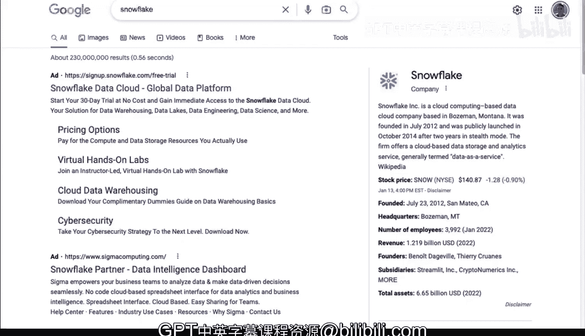
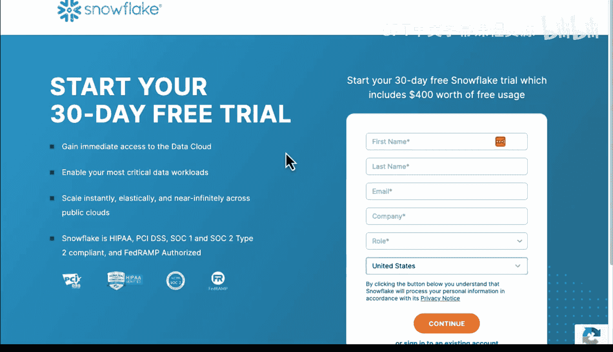
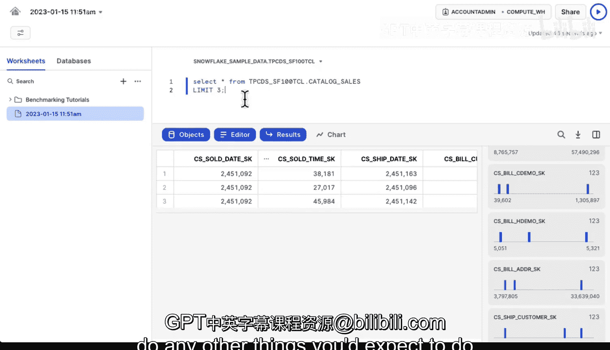

# 杜克大学《应用Python数据工程（3课全）｜Applied Python Data Engineering》中英字幕 p13 13_02_05_Snowflake Web用户界面.zh_en -BV1nz421i7KP_p13-

She go to the snowflake website。

You can sign up for a free trial。 I'd suggest doing this and walking through some of the examples as we do them in this week's lessons。

 When you first log into Snowflake， you should see something like this for information about your account up here。

Worksheets which are where you write SQL code to run on Sflake。Dashboards you can set up。

Access to data so that's where you'll go for your data services layer。

A marketplace for third party plugins， there's a big ecosystem around snowflake providing these。

Activity where you can see。A。Previous activity that's happened， this is a new account。

 so there's no activity。And administration section。

 Let's take a look at some of the data that comes supplied。With the snowflake free tier。

You can see that Snowfoake in the data section has a section for databases。And there's。

Two databases that come automatically with snowflake， this one is sample data。

As so we can see in our sample data。These are schemas。And each schema can have views or tables。

So this schema has tables， we go in we can see the individual tables。

We can see some details about the table， including who has privileges to access it。

And then we can see the columns that the table has。And we can preview the data。To do so。

 we need to select a warehouse。To run the preview query。And there we have the data。

Now let's look at how we'd write a query and stuff like， so we take a worksheet。

There is a much of sample tutorial worksheets， which were great to go through。

Or we can create our own worksheet。And you can see in our worksheet。

Well then a couple of things first we want to select a database， we don't have to。

 we can explicitly talk about the database in the query rewrite。

 but it's easy enough to select the database and the schema here。It's like this schema movie。

And then our queries will run against that database and sche and we don't have to。Explicitly。

Name them in our query。And you can see that there's auto completion。

 so I've put in the schema and I can see the tables that are in the schema。

So let's say we want to look at catalog sales。So once again。

 we need to have an active warehouse in order to run anything in Snowflake。

 so let's select the warehouse that came supplied automatically。And then we can run our query。

Here we can see the results of the query， so here's the data that we queried for。

 as well as details about the query itself， how long it took other data or other data about the data in the table so you can run lots of standard SQL from these worksheets and you can create different worksheets for different purposes。

You can create and delete tables here， you can alter permissions。

And do any other things you'd expect to do in a standard SQL implementation。

