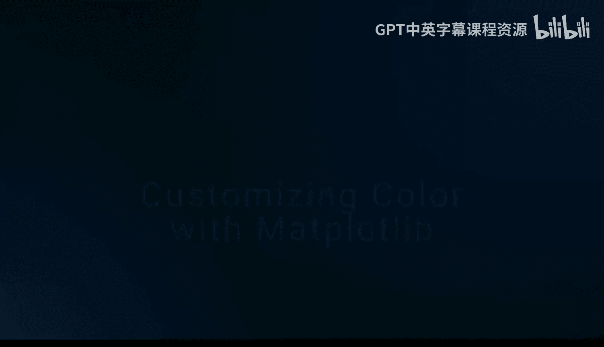
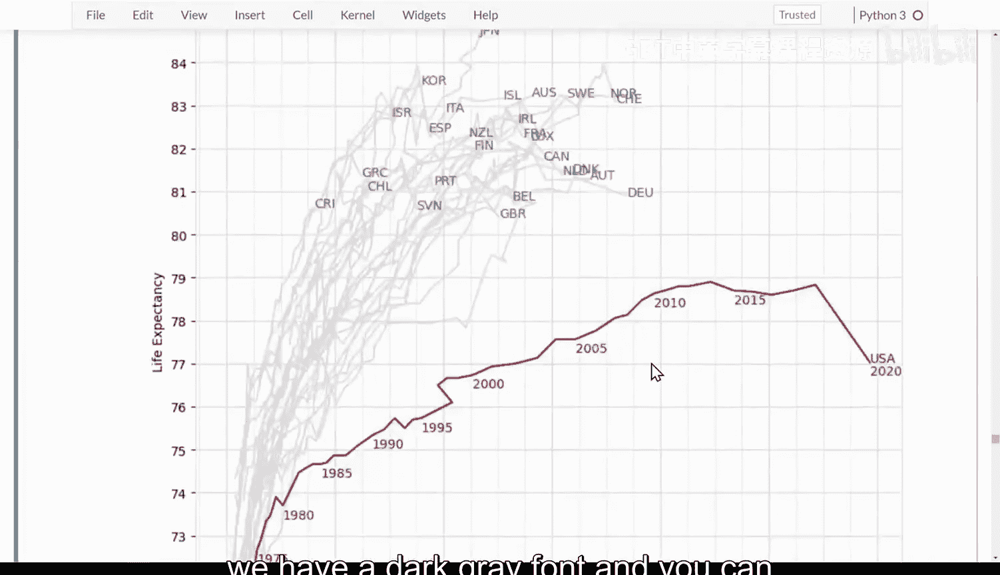

# 杜克大学《应用Python数据工程（3课全）｜Applied Python Data Engineering》中英字幕 p130 31_02_04_Matplotlib颜色定制.zh_en -BV1nz421i7KP_p130-

In this section， we're going to look at how to adjust color with map plottlib。

Let's load our line plot data here and let's make our plot。Okay。

 we can see that we've got red and gray and we've got a darker black color。 actually not black。

 It' it's a darker gray。 So let's look at our code here and see if we can understand what's going on。

 You can see I I made variables for gray， dark gray and red up above。

 You can see there's a little for loop up here。 We're looping over Xtic color Y tick color and access label color and setting those to the dark gray。

 that is setting these labels and the tick values to that dark gray color。 It's actually not black。

 but it's dark gray。Again， this is one of those things that I wish you would set with a function or method call。

 but we're doing this by setting the RC parameterss。Down later in the plot L E versus H E function。

 we've got a call to plot。 and you can see that we're setting the color there on the plot by specifying C is equal to color。

 that's the panda's mechanism for specifying the color for each line there。

 We're also specifying the country color， and we've got a little for loop that if we're in the US。

 we're specifying the year for every fifth year in red。

We can see that we are setting the grid colors here on Ax dot grid。 The color is gray。

 That's the light gray。 We can see our grid is showing that we're specifying the spine color。

 saying set spine color。 that's the box around the plot in light gray as well。 And then finally。

 we've got our font at the bottom， we have a dark gray font。

 And you can see there's our font at the bottom。 One of the things that you can do with matte plotlib is change the color of things。

 And again， you want to be aware of those colors because you want to pull your eye to things that are important。

 And color is one of the strongest ways you can do that。 So if you sort of squint at your plot。

 And you see that your eyes are focused on something that's not the main point。

 you might consider either removing that or maybe muting the color of that to draw less attention to it。

😊。

