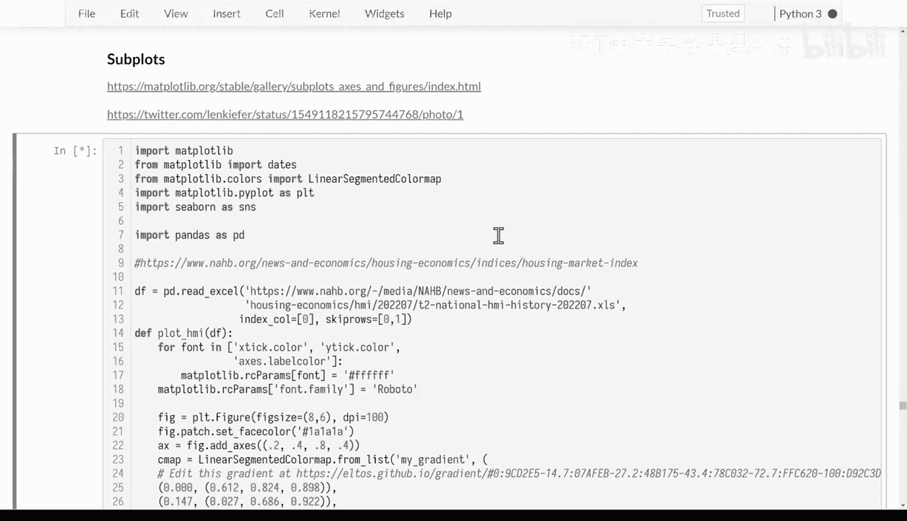
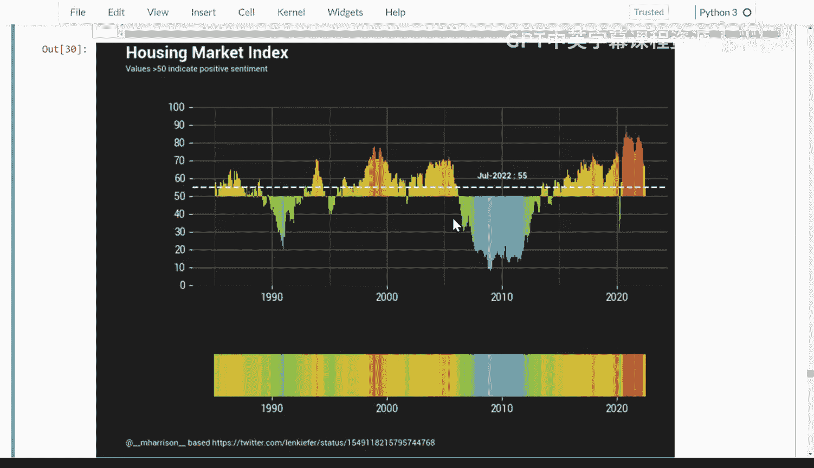
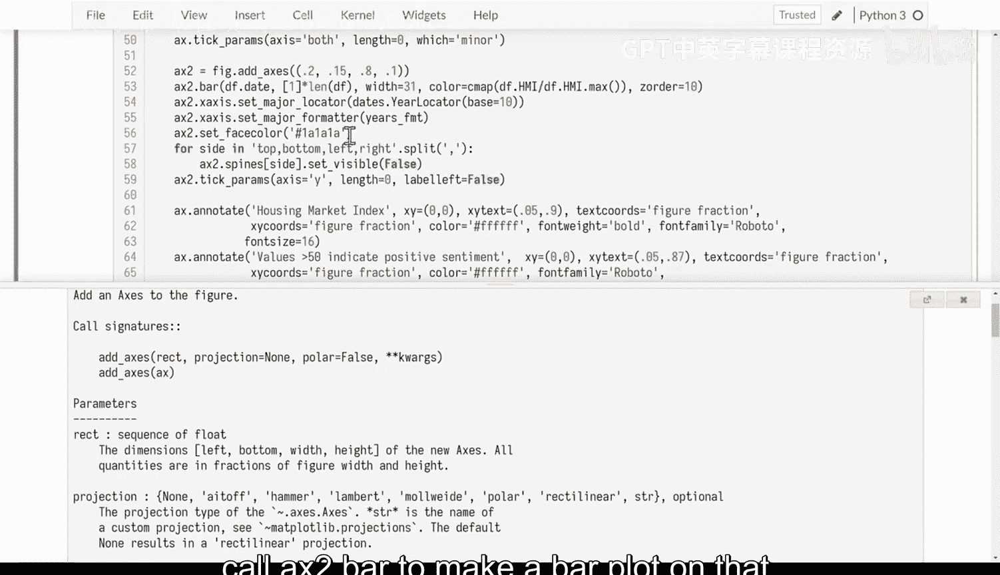

# 杜克大学《应用Python数据工程（3课全）｜Applied Python Data Engineering》中英字幕 p131 32_02_05_Matplotlib坐标轴定制.zh_en -BV1nz421i7KP_p131-

In this section， we're going to talk about subplots in mapplotlib to understand subplots。

 It's important to know that mappllib has the notion of a figure and an axes。

 I haven't really talked about this， but I've got a bunch of code that I've been running that does this。

 So you can think of a figure as the paper on which a plot is created。

 And then an axes as a plot on that paper。 And generally， a figure will have one axes on it。

 but they can have multiple。 You can stick in multiple。Axes on a figure。

 So I'm going to show an example of a figure with multiple axes on it。 Okay。

 this is a plot based on a tweet by Lynn Keeffer， who tends to plot a lot of housing market information。

 Again， if you want to dive into that。 I've got a link to subplots and axes。

 You can look at the map plot web documentation to dive into that。

 So here is a plot about the housing market index。 This is actually a single figure。

 The black thing is the figure。 And then there are two axes on it。

 There's one that has a bar plot up above。 And then there's this thing that looks like a line that has colors on it。

 That's actually a bar plot as well。 Let's look at the code that creates these。

You can see here we've got a call to PLT figure to create the figure。 We've got the fig size。

 So the width is 8 inches wide and 6 inches tall。 and then we've got a call to the fig at axes method to add an axes there。

 pull the documentation for that。 And you can see that we are passing a dimension of left bottom width and height。

 So what does this mean， it means that the left side is 20% over the bottom is 40% up。

 the width is 80% and the height is 40%。 So if we look at this plot down here。

20% over 40% up height is 40% and width is 80%。 We can see that there's another call here to axes This one's 20% over 15% up with 80% and height of 10%。

 And that's this plot down here called Ax2。 You can see up above here that we actually call ax2 bar to make a bar plot on that。

 This plot demonstrated。

How to make a figure that has multiple axes on it， There's actually a lot more ways to make multiple axes。

 You can do facets or grids。 You can put subaxxes inside of other ones。 again。

 check out the map clotlib documentation if you're curious about how to do this。

