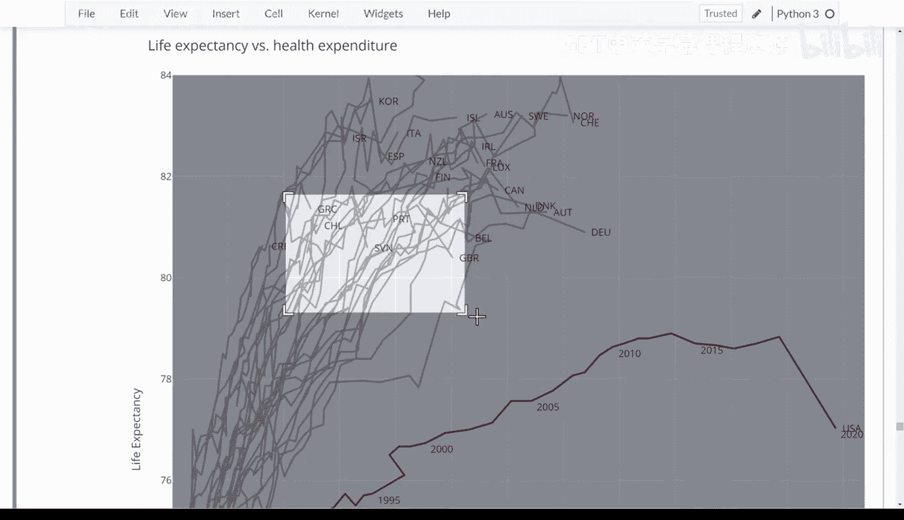

# 杜克大学《应用Python数据工程（3课全）｜Applied Python Data Engineering》中英字幕 p133 34_03_03_使用Plotly创建折线图.zh_en -BV1nz421i7KP_p133-

We need to be aware that the default back in that pandas uses is map plotlib。

 And if we want to use plotly， we're going to need to set this plotting back into the plotly string。

 Just Fy I'm using the plotly library 5。9 here。 Let's load our line data and see if we can make a plot similar to our life expectancy versus spending data here。

 So here we go， because we set that back in to plotly。 look at that。

 this interface looks pretty similar to what we did before， But it is now using plotly to make this。

 And one of the nice things about this is that you can hover over this and you can see these points here。

 Now， again， is this the world's greatest plot is it telling us the best story。I don't think so。

 but let's see if we can clean it up a little bit。 So I'm going use this code here to clean it up a little bit。

 Let's run this and look at that。 This looks。Pretty similar to what we had above。

It has the bonus that we can hover over this， and we can get these pop ups here。

 indicating these points here。 Let's go over this code quickly and talk about what's going on here。

 So I am now saying we have this color column here。 and I'm adding this is US。

 you can see down below， I actually make an is US column。

 and it's just a boolean whether the location is US。

 This allows us to then add this color discrete map。 And if is US is equal to true or one。

 it will use red as the color otherwise it uses this A A A as the color。

We're also saying we want to use these labels， life space expectancy， health expenditure per capita。

 We're setting the width and the height there。 We are saying don't show a legend。

 We are adjusting the Y access。 and then I've got some four loops here。

 One is to add in the country names。 We're saying add annotation。

 Note that the interface here is different from mapplotlib because this is not built on mappllolib It has a different interface。

 And then I'm also looping over the US years to print out the years there。 Finally。

 at the bottom here， I'm putting in a title， and I'm setting the tick values。

 You can see the plot is similar， but the way to create it is different because it's using a different library。

One of the nice things about this if I want to， I can zoom into these。

 and we can look at these individual points。 In this example。

 we showed how to do a line plot with plotly。 Once you set that back in。

 making the basic plot is the same as it is with pandas and map plotlib。 However。

 if we want to start tweaking that， we have a different interface to do that。

