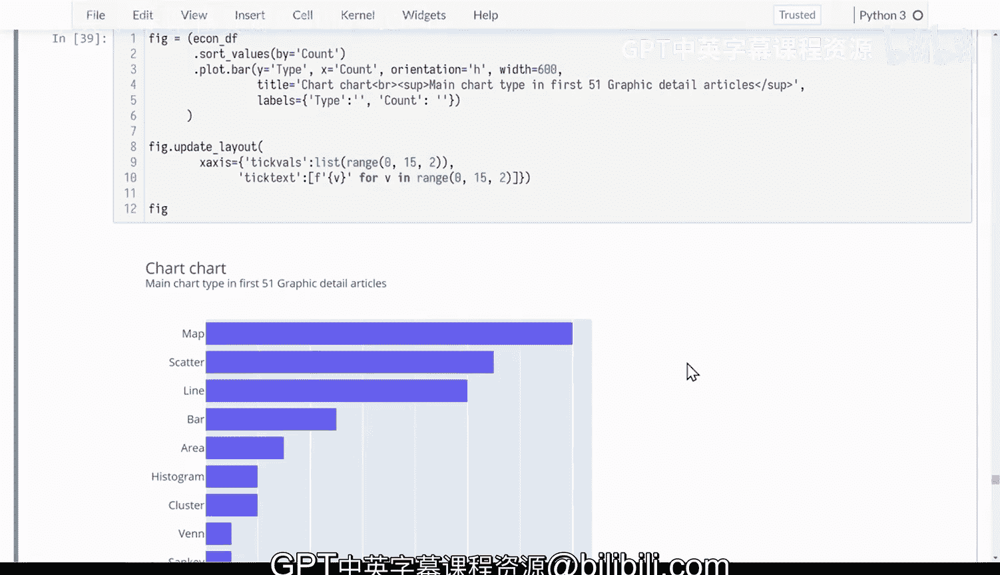

# 杜克大学《应用Python数据工程（3课全）｜Applied Python Data Engineering》中英字幕 p134 35_03_04_使用Plotly创建条形图.zh_en -BV1nz421i7KP_p134-

In this next example， we're going to look at a bar plot with the plotly library。

 Let's load our econ data。And let's try and do a plot dot bar。 There we go。 That looks pretty good。

 And that's generally how I would make this。If we want to customize it a little bit more， we can。

You can see that now I'm doing a horizontal bar plot。 How did I get that。

 I said orientation is equal to H。 I'm setting the title there。

 Note that I'm using HTML to put in a breaking space and the subtitle。

 I'm saying the labels for the X and Y axis are the empty strings note up above here。

 put in type and count。 I want to get rid of those。 So they're not distracting me。

 And then I'm just updating the tick values there。

