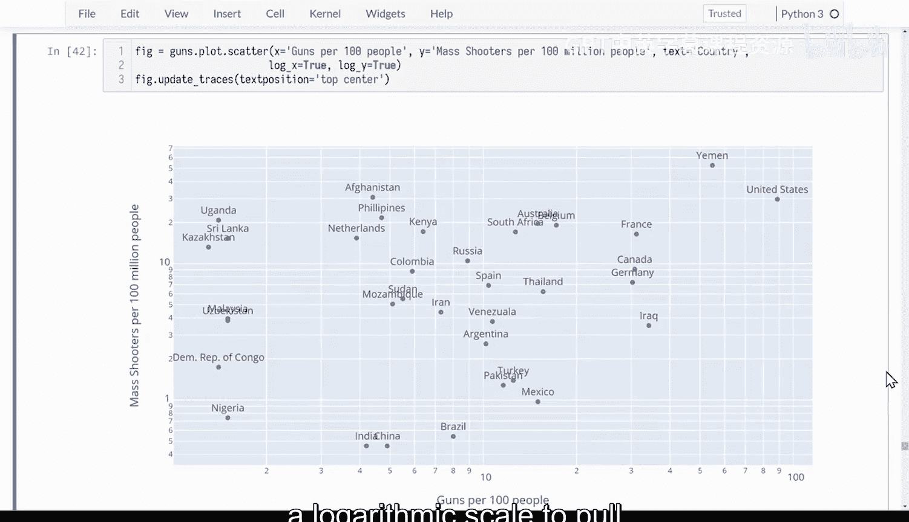

# 杜克大学《应用Python数据工程（3课全）｜Applied Python Data Engineering》中英字幕 p135 36_03_05_使用Plotly创建散点图.zh_en -BV1nz421i7KP_p135-

In this example， we're going to look at making a scatter plot with this plotly library。

Let's load up our gun data。And let's make a scatter plot。Again。

 this looks very similar to what we had with pandas up above。

 One of the nice things about this is that we can hover over this and we can get data。 Now。

 you'll note that this does not have the location。 Maybe we want to add that。

 Let's see if we can tweak it a little bit。 So here's what I'm going to do。

 I'm going to say text is equal to country。 And now we have the labels up above that。

 I'm saying put that at the top and center above the point。

 I'm also demoing something here that we didn't see in mappltlib。

 The ability to change the scale of the X and Y access to a log scale。 Now。

 I'm not necessarily suggesting that this change to a log scale is great for illustrating the point that we want to。

 In fact， I think it weakens the point that the United States is an outlier。 So I would not do this。

 but I just want you to be aware that sometimes it is nice to be able to use a logarithmic scale to sort of pull apart or Ts and understand the data a little bit better。

