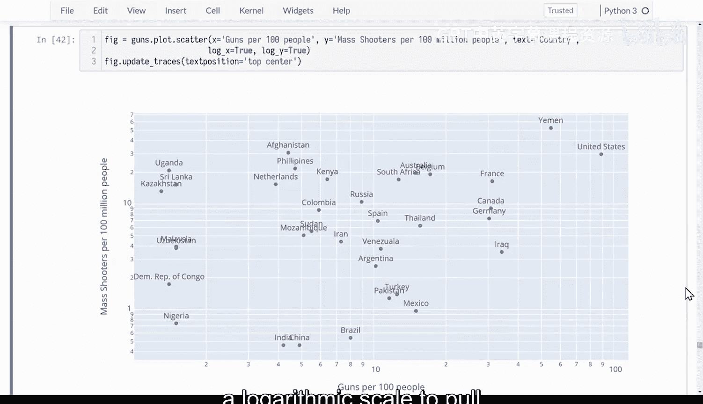

# 应用Python数据工程：3.5：使用Plotly创建散点图 📊


在本节课中，我们将学习如何使用Plotly库创建交互式散点图。我们将加载数据，制作基础图表，并探索如何通过添加文本标签和调整坐标轴比例来增强图表的可读性和信息量。

---

上一节我们介绍了Plotly的基础，本节中我们来看看如何用它制作一个散点图。

首先，加载我们的枪支数据。
```python
# 假设 gun_data 是已加载的Pandas DataFrame
import plotly.express as px
fig = px.scatter(gun_data, x='人均枪支数', y='凶杀率')
fig.show()
```

生成的图表看起来与之前用Pandas制作的非常相似。

Plotly的一个优点是图表是交互式的。我们可以将鼠标悬停在数据点上以获取详细信息。

不过，您可能会注意到，悬停信息中默认不包含国家名称。也许我们想添加这个信息。

让我们看看是否能稍微调整一下图表。以下是具体做法：
```python
fig = px.scatter(gun_data, x='人均枪支数', y='凶杀率', text='国家')
fig.update_traces(textposition='top center')
fig.show()
```

现在，每个数据点的上方都显示了国家标签。`textposition='top center'` 参数将标签置于点的正上方居中位置。

这里我还演示了一个在Matplotlib中不常见（或不易实现）的功能：将X轴和Y轴的刻度改为对数比例。
```python
fig.update_xaxes(type="log")
fig.update_yaxes(type="log")
```

需要说明的是，对于当前数据，改用对数比例尺可能并不利于阐明我们想表达的观点。事实上，我认为它削弱了“美国是一个异常值”这一论点。因此，我不会在此处使用它。

但我希望您了解，有时使用对数比例尺有助于拉开数据点的间距，从而更好地观察趋势和理解数据。

---



**本节课总结**


本节课中我们一起学习了使用Plotly创建交互式散点图。我们掌握了基础绘图方法，学会了如何通过 `text` 参数添加数据标签，并了解了如何使用 `update_xaxes` 和 `update_yaxes` 方法将坐标轴调整为对数比例。记住，图表格式的选择应服务于清晰传达数据洞察的目的。