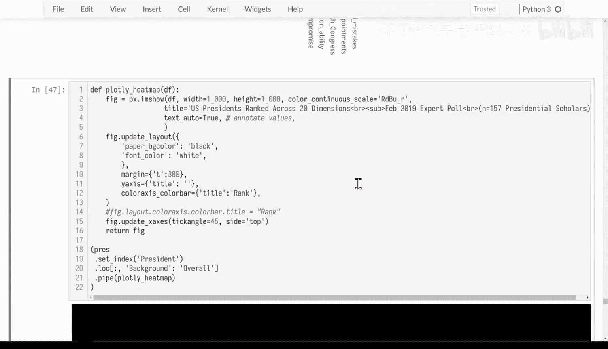
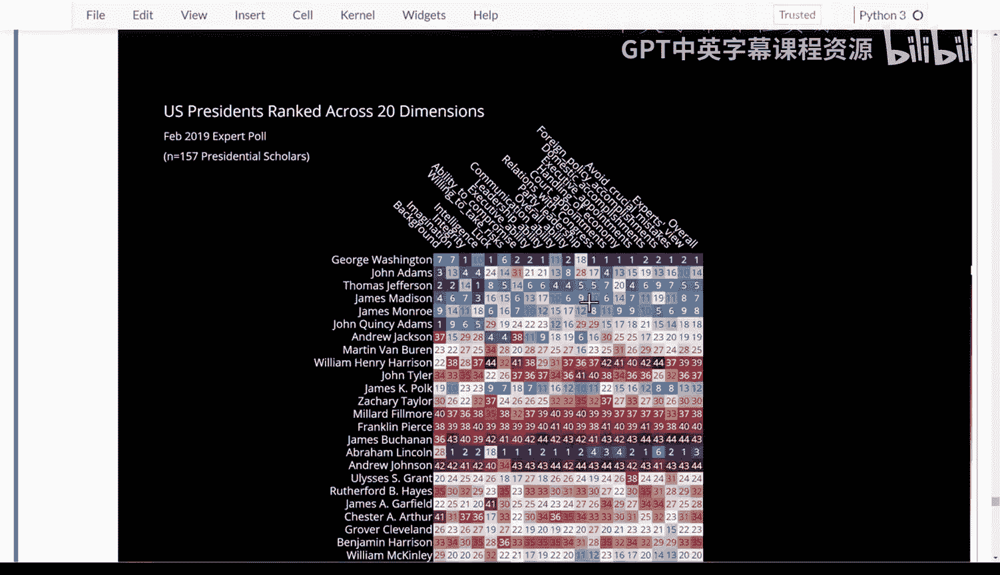
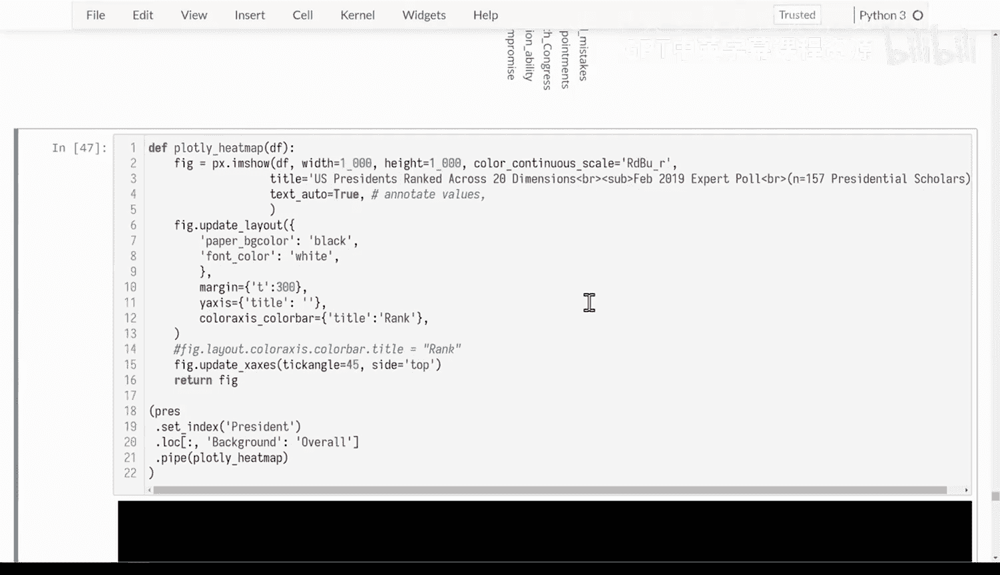

# 杜克大学《应用Python数据工程（3课全）｜Applied Python Data Engineering》中英字幕 p136 37_03_06_使用Plotly创建热力图.zh_en -BV1nz421i7KP_p136-

In this example， we're going to look at using plotly to make a heat map。

 Let's load our presidential data。And let's call I am show。

I am sure it is similar to what we have in map Ptlib， but we can throw this in。

 and we can make this heat map here。 The nice thing about plotly is that we can hover over this。

 and we can get information about this。 And especially if you have a lot of rows and columns。

 now you have the ability to hover in and zoom in。 And this makes it really nice。

 something that you can't really do with map plotlib， at least not at the same smoothness。😊。

This is something you can do in mat Plalo as well， but the interactivity suffers quite a bit。Okay。

 I'm going try and make this a little bit more like we had on the other one。

 So what am I going to do， I'm going to change the scale here。 So it doesn't call the color map。

 It calls us the color continuous scale。 setting a title here。 I'm saying text auto is equal to true。

 If I do that， I get the values inside of that。 I'm saying make the background color black。

 make the font color white， make a margin of。300 set the title in the Y axis to the empty string and put the rank on there。

 Let's run this。

And there's our plot。 I think that's a pretty good plot。

Pretty similar to what we had above。 Certainly this plot is a lot easier to use than raw mat plotlibb。

 maybe not quite as easy as seaborn， but does a pretty good job。

