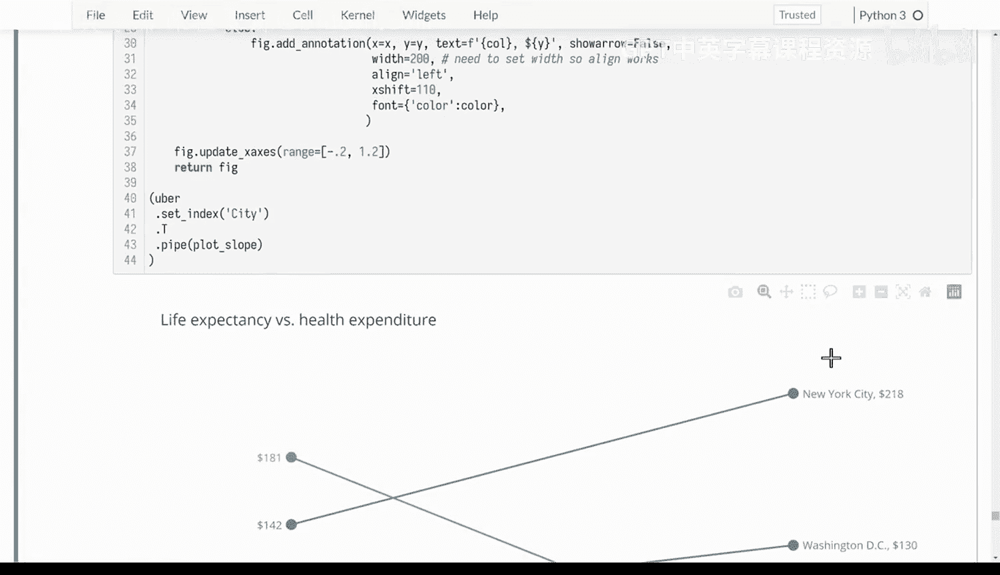

# 杜克大学《应用Python数据工程（3课全）｜Applied Python Data Engineering》中英字幕 p137 38_03_07_使用Plotly创建斜率图.zh_en -BV1nz421i7KP_p137-

In this example， we're going to make a slope graph with the plotly library。 Let's load our data。

Let's say plot that data。And there's our plot that seems to make sense。 Again。

 this is very similar to what we had with our normal pandas。

 We're going to stick city into the index。 We're going to transpose that。

 And now we're going to do a plot。 This is going to plot each column as a line and is' going to put Uber and position0 in personal car in position 1。

 There we go。 That looks okay。 General how we do this is a bar plot。 Instead。

 This is a stacked bar plot。 I don't think it tells the story that we want by default。

 It does a stacked bar plot。 pandas does not do a stacked bar plot with mat plot by default。

 But we can say bar mode is equal to group to make it unsted。 This is a pretty good plot。

I think it kind of tells the story that we want。 It's just not drawing as much attention to it。

 It just looks like to me， if I squint at this， there's a bunch of red and blue。

 If I look at it a little bit more， I see that there's tall blue over by Dallas。

 But let's see if we can make a slope plot to draw attention better。 So look at that。 There we go。

 This is almost the same plot that we had up above。 But it's using plotly。

 So let's go over what's going on here。 We're saying add markers。

 So markers is equal to true to add those dots。 We're adding a title up at the top。

We're saying change the marker sizes， make those bigger。

 You can see that those marker sizes are a little bit bigger than what we had in our scatter plots above。

 We're saying the background color is white。 Don't show a legend set the title clear out the X axis title。

 Don't show the Y axis。 And then I'm looping over the columns there to annotate the dollar values on the left hand side and the city values on the right hand side。

 Again， note that this interface for doing this is different than what we have in map plotlolib。

 It's a completely different library。 Finally， I'm updating the X axis at the bottom there just to adjust the spacing to be something that I like。

 In this example， we saw how to make a slope graph using plotly。 Again。

 we had to sort of build this up。 But I think it does a pretty good job。

