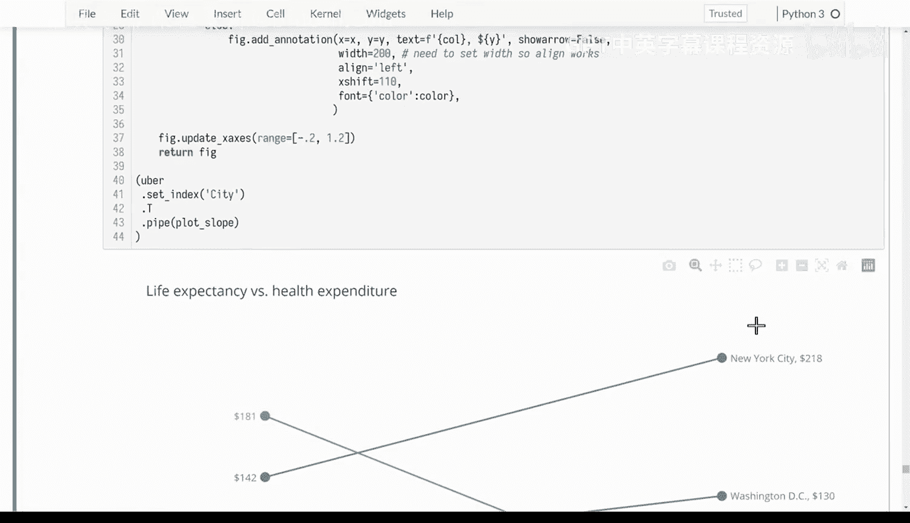

# 数据可视化：第38章：使用Plotly创建斜率图 📈


在本节课中，我们将学习如何使用Plotly库创建一个斜率图。斜率图是一种用于比较两个时间点或两种状态下数据变化的有效图表。我们将从加载数据开始，逐步构建图表，并最终通过调整样式来突出显示关键信息。

---

## 加载与准备数据

首先，我们需要加载数据。假设我们已经有了一个包含城市和两种交通方式（如Uber和个人汽车）使用率的数据集。

```python
import pandas as pd

# 假设df是我们的数据框
# 将‘city’列设为索引，并转置数据，以便每列代表一条线
df.set_index('city', inplace=True)
df_transposed = df.T
```

## 创建基础图表

接下来，我们使用Plotly绘制基础图表。默认情况下，Plotly会将每个列绘制为一条线，并将‘Uber’和‘个人汽车’分别放在位置0和位置1。

```python
import plotly.graph_objects as go

fig = go.Figure()
for column in df_transposed.columns:
    fig.add_trace(go.Scatter(x=df_transposed.index, y=df_transposed[column], mode='lines+markers', name=column))

fig.show()
```

生成的图表看起来合理，但可能无法充分突出我们想要展示的故事。

## 探索条形图

通常，我们可能会使用条形图来展示这类数据。默认情况下，Plotly会生成堆叠条形图。

```python
fig = go.Figure(data=[
    go.Bar(name='Uber', x=df_transposed.index, y=df_transposed.loc['Uber']),
    go.Bar(name='Personal Car', x=df_transposed.index, y=df_transposed.loc['Personal Car'])
])
fig.update_layout(barmode='stack')
fig.show()
```

然而，堆叠条形图可能无法清晰地传达我们想要的信息。我们可以通过设置`barmode='group'`来创建分组条形图。

```python
fig.update_layout(barmode='group')
fig.show()
```

分组条形图是一个不错的图表，它展示了数据，但可能没有足够地吸引注意力到关键变化上。

## 构建斜率图

为了更有效地吸引注意力，我们可以创建一个斜率图。斜率图通过连接两个点的线段来强调变化。

以下是创建斜率图的步骤：

1.  **添加标记点**：在数据点上添加标记，使其更明显。
2.  **设置标题和样式**：添加图表标题，调整标记大小和背景颜色。
3.  **自定义坐标轴**：清除不必要的坐标轴标签，并添加数据标签。
4.  **调整布局**：微调X轴间距，使图表更美观。

```python
fig = go.Figure()

# 为每个城市添加线段和标记
for city in df.index:
    fig.add_trace(go.Scatter(
        x=[0, 1],
        y=[df.loc[city, 'Uber'], df.loc[city, 'Personal Car']],
        mode='lines+markers',
        marker=dict(size=10),
        name=city
    ))

# 更新布局
fig.update_layout(
    title='交通方式使用率变化',
    plot_bgcolor='white',
    showlegend=False,
    xaxis=dict(
        title='',
        ticktext=['Uber', 'Personal Car'],
        tickvals=[0, 1],
        showgrid=False
    ),
    yaxis=dict(
        title='',
        showgrid=False,
        showticklabels=False
    )
)

# 添加数据标签
for i, city in enumerate(df.index):
    fig.add_annotation(x=0, y=df.loc[city, 'Uber'], text=f"${df.loc[city, 'Uber']}", showarrow=False, xanchor='right')
    fig.add_annotation(x=1, y=df.loc[city, 'Personal Car'], text=city, showarrow=False, xanchor='left')

fig.show()
```

## 总结



在本节课中，我们一起学习了如何使用Plotly创建斜率图。我们从加载和准备数据开始，探索了条形图作为替代方案，并最终构建了一个斜率图来更有效地展示数据变化。斜率图通过连接两个点的线段，能够突出显示变化，使观众更容易理解数据背后的故事。虽然Plotly的接口与Matplotlib不同，但它提供了强大的自定义功能，可以帮助我们创建出既美观又信息丰富的图表。