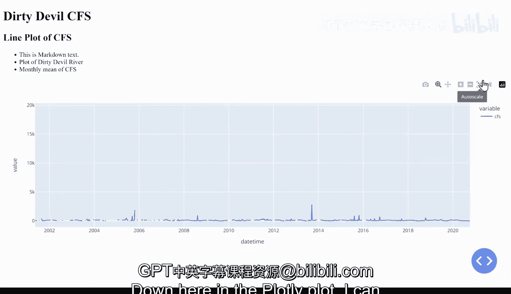

# 杜克大学《应用Python数据工程（3课全）｜Applied Python Data Engineering》中英字幕 p139 40_03_03_使用Dash创建折线图.zh_en -BV1nz421i7KP_p139-

In this video， I'm going to show you how to make a simple dash dashboard。

 The first thing you need to do is install dash。 You can do that with Pip。

 Sa Pip install dash If you're using Pip to manage your installations。After you've installed dashash。

 you need to make a little script， so here's a basic script right here。

Let me just go over what's going on in this at the top of this， you can see that I am importing dash。

 I'm also importing pandas and plotly。 The next thing that's important here is I'm creating an app。

 This is a dash application。 We'll see down below that I'm going to add some features to that。

After that， I am changing the back end for pandas rather than using mappllib。

 It's going to use plotly。 Now， the next couple things here are just pandas code。

But the key thing here is that I'm generating a figure at the bottom。

 This is the result of calling plot。 and instead of returning a map plotlet object。

 this is going to return a plotly object。Okay， and here is the rest of our code at the bottom here。

 I've got this layout where I'm using a syntax for dash to add Hm to a web page。

 You can see that I'm adding an H1 tag and I'm adding markdown。 This is kind of cool。

 I'm just passing in a Python string here that has markeddown in it。 It will be rendered as Hm。

 And then finally， I'm adding this graph object。 You can see that it has an I D。

 and it says the figure that I'm passing in， which is the figure that I created using pandas code at the very bottom。

 I have the code that says if you execute this file。 start the server。

 Let's run this and see it happens。 in order to run this。

 I need to say Python and that file and then I go to that URL that it's going to start the dashboard on。

😊，So here is my code。Let's run this first one here。Okay， and here is the plot you can see down here。

 This is a plotly plot up to the top。 You can see that it says markdown。

 we added in some markdown content。One of the nice things about this is because it's HTML I can zoom in and zoom out and it fits on the page without me having to mess around with it。

Down here in the plotly plot， I can zoom into this。 I can reset the axis。

