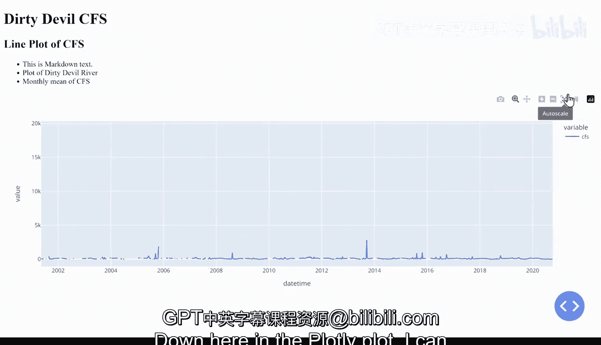

# 应用Python数据工程：第3课：使用Dash创建折线图


在本节课中，我们将学习如何使用Dash框架创建一个简单的交互式仪表盘，并展示一个折线图。Dash是一个基于Python的Web应用框架，特别适合用于构建数据可视化界面。

## 概述

我们将从安装Dash开始，然后编写一个基本的脚本，该脚本会创建一个包含标题、Markdown文本和一个交互式折线图的网页。整个过程将结合Pandas进行数据处理，并使用Plotly作为绘图后端来生成图表。

## 安装Dash

首先，你需要安装Dash库。如果你使用Pip来管理Python包，可以通过以下命令进行安装：

```bash
pip install dash
```

安装完成后，你就可以开始编写Dash应用程序了。

## 编写基础脚本

接下来，我们创建一个Python脚本。以下是脚本的基本结构：

```python
import dash
import pandas as pd
import plotly.express as px

# 创建Dash应用实例
app = dash.Dash(__name__)

# 设置Pandas使用Plotly作为绘图后端
pd.options.plotting.backend = "plotly"

# 使用Pandas创建示例数据并绘图
df = pd.DataFrame({
    'x': [1, 2, 3, 4, 5],
    'y': [10, 11, 12, 13, 14]
})
fig = df.plot(x='x', y='y', kind='line')

# 定义应用的布局
app.layout = dash.html.Div([
    dash.html.H1("我的第一个Dash仪表盘"),
    dash.dcc.Markdown("""
        这是一个使用**Markdown**格式的段落。
        我们可以在这里添加说明文字。
    """),
    dash.dcc.Graph(
        id='example-graph',
        figure=fig
    )
])

# 运行服务器
if __name__ == '__main__':
    app.run_server(debug=True)
```

## 代码解析

现在，让我们详细解析上面的代码。

在脚本顶部，我们导入了必要的库：`dash`、`pandas`和`plotly.express`。接着，我们创建了一个Dash应用实例。

之后，我们通过设置`pd.options.plotting.backend`将Pandas的绘图后端从默认的Matplotlib切换为Plotly。这意味着后续调用Pandas的`.plot()`方法将生成Plotly图形对象，而不是Matplotlib图形。

接下来的几行是标准的Pandas代码，用于创建一个简单的DataFrame并绘制折线图。关键点在于，`.plot()`方法现在返回的是一个Plotly图形对象`fig`。

## 构建网页布局

在定义应用布局的部分，我们使用了Dash的HTML组件。我们添加了一个一级标题（`H1`）、一个Markdown组件和一个图形组件。

Markdown组件允许我们直接传入包含Markdown格式的Python字符串，Dash会自动将其渲染为HTML。图形组件则通过`figure`参数接收我们之前创建的Plotly图形对象`fig`。

## 运行应用

在脚本的最底部，我们添加了启动开发服务器的代码。当直接运行此脚本时，Dash应用将在本地启动一个Web服务器。

要运行脚本，请在终端中执行：

```bash
python your_script_name.py
```

执行后，终端会输出一个本地URL（通常是`http://127.0.0.1:8050`）。在浏览器中打开这个URL，就能看到你的仪表盘了。

## 查看结果

运行上述脚本后，你将在浏览器中看到一个网页。网页顶部显示了我们添加的标题和Markdown文本。

网页下方则展示了交互式折线图。由于图表由Plotly生成，它具备丰富的交互功能：你可以用鼠标拖拽来缩放图表区域，也可以双击图表或使用工具栏的“重置轴线”按钮来恢复原始视图。

此外，因为整个仪表盘是基于HTML构建的，所以它能自适应不同的屏幕尺寸，无需手动调整图表大小。

## 总结



本节课中，我们一起学习了如何使用Dash创建简单的数据可视化仪表盘。我们完成了从安装Dash、编写应用脚本、设置Plotly绘图后端，到构建包含文本和交互式图表的网页布局的全过程。Dash结合Pandas和Plotly，为快速构建数据驱动的Web应用提供了一个强大而灵活的工具集。