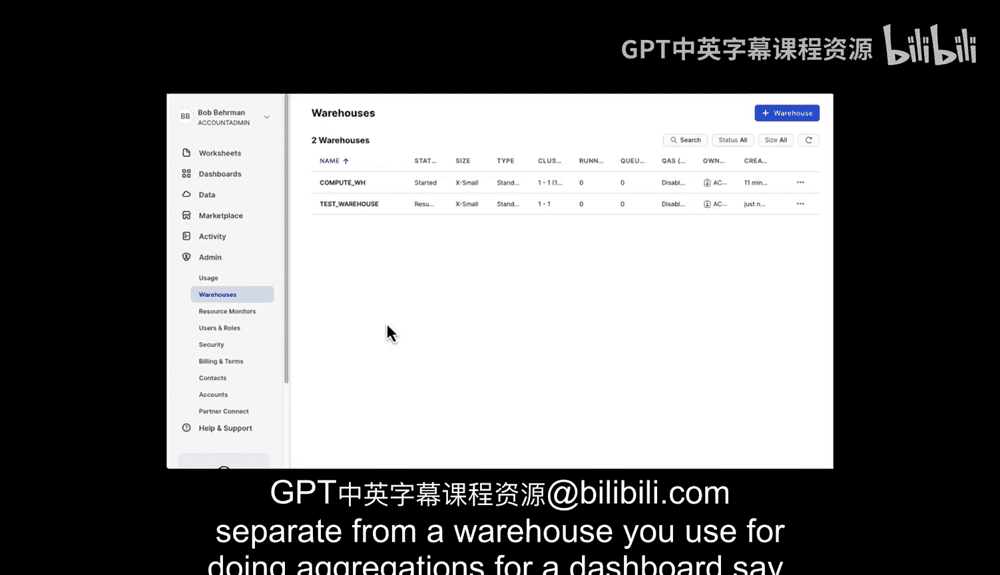

# 杜克大学《应用Python数据工程（3课全）｜Applied Python Data Engineering》中英字幕 p14 14_02_01_Snowflake导航.zh_en -BV1nz421i7KP_p14-

Now， let's look at some of the administration you can do in Snowflake。

So one thing we can do is go into users and roles。And we can see all the current users and roles in snowflake。

 so the。Account that you log in with。Will be the account owner。Add other users at this point。

 if we want。Or we can look here and look at roles。So roles are interesting。

 you can see that these are the six roles that come with snowflake by default and each row has certain permissions。

 you can also create new roles with specific permissions。

And here we can see the inheritance that these roles have。So。

The accountant man has permissions for everything。And then there's more limited roles for the system amin。

 security amin。And even less permissions down here。For the user of men。So let's add a role。

 let's call this our API role。We'll put it。Use， admin， we'll create our role。So now we can see。

Our API role。Inherited down from the userd min。Let's look at creating a warehouse to run a compute job。

So we could name our warehouse。And decide the size of the warehouse。

It's probably a good idea to go as small as possible because the size determines。

OfThe number of credits used， you can add a comment if you want。So generally。

 you want your warehouse to auto resumeum and auto suspend。

What this means is that when you run a query against this warehouse。

Where else will start up if it's not already running， run the query。

 and then after a certain amount of time， suspend。Remember。

 you only paying in credits for the amount of time the warehouse is up。

 so you don't want warehouses up and not doing anything if you can help it。

So you can lower the number of minutes before it turns off down to one。Or using Snowflakes SQL。

 you can lower even shorter than one minute。This is where you would choose if you want the standard。

Or Snow Park style warehouse for this free account， you only have a choice of using the standard。

Now we can see there's the compute warehouse， which comes automatically set up when you sign up for the account and now we have a new warehouse。

You may want to have different warehouses for different users or for different uses。

 so perhaps a warehouse specifically for ingesting data separate from a warehouse you use for doing aggregations for a dashboard。

 say。

