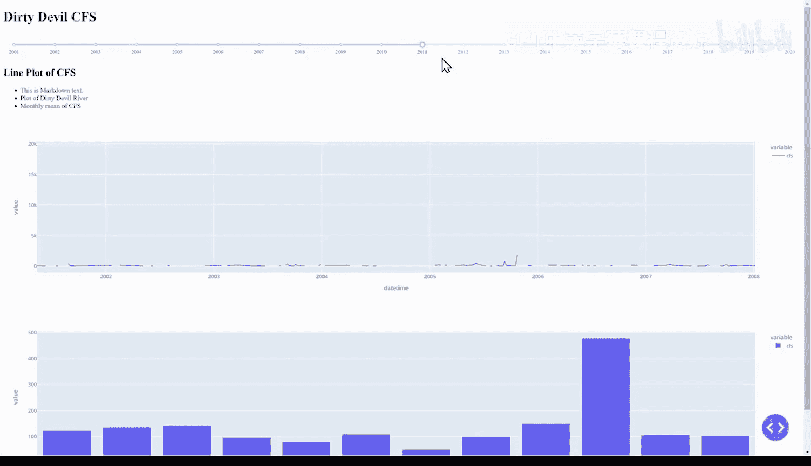

# 杜克大学《应用Python数据工程（3课全）｜Applied Python Data Engineering》中英字幕 p140 41_03_04_使用Dash创建条形图.zh_en -BV1nz421i7KP_p140-

In this video， I'm going to show you how to make a bar plot with plotly and add a widget to it。

Here's the code。 This looks pretty so much what we saw before。

 I have a few more imports that I'm importing here。

 You can see that I'm importing this input from dash in order to make a widget。

 We're making the dash application at the top。 I'm setting the back end for pandas。

 I've got some code here to make some plots。 You can see I'm making two figures。

 One is the line plot that we had before。 and the second is a bar plot。 That's fig 2。

 Now down at the bottom here。 I've got a little bit more going on。

 You can see that I'm setting the layout attribute。

 I'm creating an H1 tag and then I'm breaking space tag。😊，I also have a slider。

 This is a widget that I'm getting from dash。 I'm setting the minimum value to my minimum year from my data。

 my maximum value to my maximum year。 and the starting value to the maximum year。

 I'm also setting the steps。 So we go in increments of one for years。

 And then I'm setting how those marks look on the slider。 I'm also giving that an Id。

 I'll need the Id because I'm going to connect that slider to a plot。

 And we'll see that later on here。 I've got some markdown down there。 And then below that。

 I'm adding the line graph， and I'm also adding the bar graph with their Is。To make this interactive。

 I need to。Add these functions and decorate them with the app callback decorator。

 Let's look at the first one here。 update line figure。

 You can see that the input to this function is the max year。 Where is that coming from。

 That is coming from the decorator， which we see up above。

 You can see that it says the input comes from the Id year slider。 Let's look where year slider is。

And we can see that the I D year slider comes from that slider object。 The output is the figure。

 The line graph。 And you can see that the Id in the output matches the Id in the div up above。

 So when they change the slider。 This will be called。

 and it should output a figure and you can see that this is returning a plot。

 So it is returning a figure and that will update the image there。

 I've got another decorated function here that is connecting the year slider with the bar graph。

 So basically， what this is allowing us to do， we have a slider when we change that slider that is going to update both our line graph and our bar graph。

 at the bottom here， I am just kicking off the server， if I'm running this code。 Let's run the code。

Okay， I'm going to zoom out here so you can see it a little bit better at the top。

 we have the slider。Below that， we've got our markdown。 below that， we've got our lime plot。

 And at the bottom here， we have our bar plot。 Now， you can see this slider here。

 It is set to our maximum ear。 If we grab this and pull it down。

 you can see that our lime plot is changing and the bar plot is being dynamically updated as well。

This video showed how we can connect widgets with graphs and update them dynamically。

