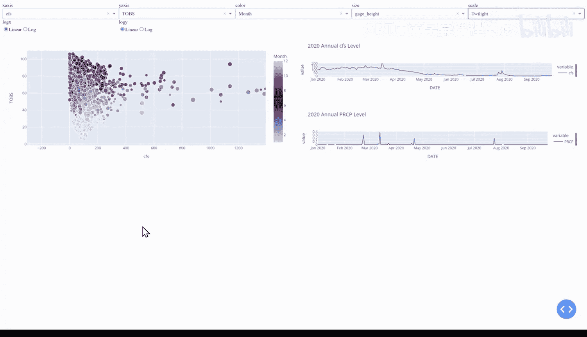

# 杜克大学《应用Python数据工程（3课全）｜Applied Python Data Engineering》中英字幕 p141 42_03_05_使用Dash创建散点图.zh_en -BV1nz421i7KP_p141-

In this next video， I'm going to show a scatter plot。 It's going to have a few more widgets。

 It's also going to show how you can connect， hovering over or clicking on an object in a scatter plot to update another section。

 Let's look at the code。 We've got our imports。 We are making amp or' sending the back into plotly。

 I've got a bunch of pandas code where I'm creating a data frame。Now。

 the crux of the dash code is this part down here at the bottom。

 we can see that there's a gi scatter function。 This is going to create our scatter plot。

 You can see there's a bunch of input there that allows us to change how the scatter plot is。

 When I demo this， I'll talk about what the different inputs are there。

 But basically we are using the input to determine how we make a plot。

 and then we're returning the plot。Here is the layout。

 You can see that I'm adding a bunch of drop downs。

 one for the X axis we're allowing you to choose which column you want to plot in the X axis of our scatter plot similar with the Y axis。

 we can also allow you to choose what。Column you want to use to color the data and to size the points。

 We also have a scale。 That's the color map that we're going to use。And then below that。

 we've got a radio box to allow the user to check off whether they want a normal X axis or logarithmic X axis。

 same thing for Y down below that， we've got a scatter plot that we're going to add in there。

 and then we've got two more plots。 We've got a CFS graph and a precipitation graph。

The next thing I have down here is a little function that will get the graph for a given year and what interesting thing with these two functions down here CFS year myself hover and precipi hover is that they have an input and so that says the component property is hover data So when you hover over something we are going to call this function and the output is going to be a new graph。

 so we're going to create a new CFS graph and a new precipitation graph based on what we're hovering over in the scatter plot。

And the new graph will be this code up here， which generates the new graph。

 you can see that we're passing in the hover data。 we're getting the XY value from that。

 and then based on the XY value， we are getting the year from that。Okay。

 let's run this and see what it looks like。Here is our graph on the left hand side。

 We can see that there is a scatter plot I can zoom into this。And then on the right hand side。

 you can see that there's two graphs。 There's a line graph for the CFS level。

 and there's another one for the precipitation level。

 What I can do is when I hover over these plots in the scatter plot。

 you can see this one is from 2018。 It updates those plots with the data from 2018。

 Here's one from 2012。 You can see that is data from 2012 up here， I can choose different columns。

 If I want to look at gauge height instead of CFS， I can plot gauge height there。

I'm going to go back to CFS。 if I want to put this on a log scale。

 I can put it on a log scale in the X axis。I'm going to come over here to scale and change the scale to a cyclic scale。

 So twilight is a cyclic scale because I am coloring by month。

If I choose a cyclic scale that wraps around at the year end。So I think this is a cool plot。

 let me just describe what's going on here。We can see that white or lighter colors is either January or December。

 So we're starting off at the bottom of this plot as we go through the year， we go to the blue。

 We're seeing that when we start off， we have cold temperatures we're warming up through the year through the blue。

 You can see that we're also getting a little bit more cubic feet per second running down that river。

 And then as we go darker。 we're still warming up And then it looks like we get up to the top。

 during the top of the summer。 We have maybe less cubic feet per second。

 as the summer changes into the fall。 We're have less cubic feet per second。

 and then it's cooling off。 and then we're getting back into the winter months。

 I think this is really cool， you can see sort of a cyclical pattern going on in this In this video。

 we looked at making a scatter plot， those was a little bit more involved。

 It had a bunch of widges that we connect， we could also see that we could connect hovering over something to have a callback。

And dynamically， generate other plots from this。 This is really powerful。 Hopefully。

 you can see that you can set this up with dash with relatively little code。

