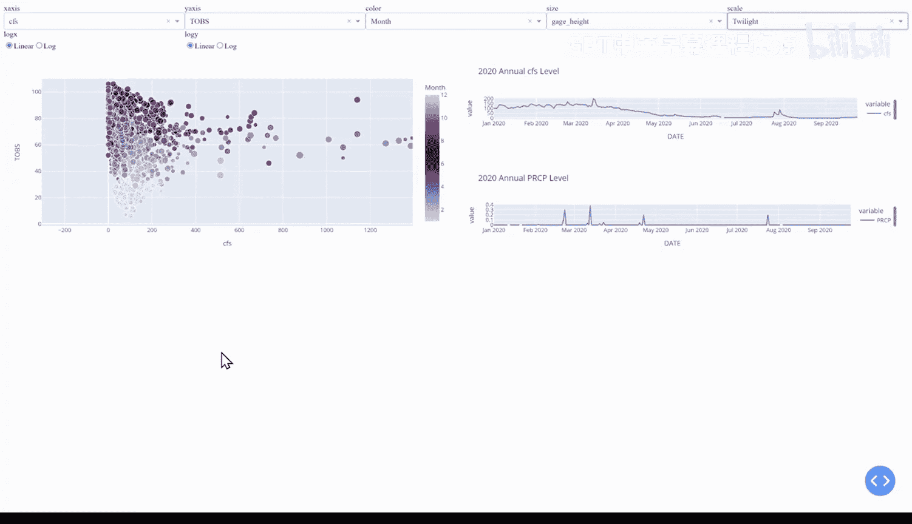

# 应用Python数据工程：3.5：使用Dash创建交互式散点图 📊


在本节课中，我们将学习如何使用Dash框架创建一个功能丰富的交互式散点图。这个图表不仅包含多个控制部件（Widgets），还能实现图表间的联动：当鼠标悬停在散点图的某个数据点上时，会自动更新页面上的其他图表以显示该点的详细信息。

## 概述

我们将通过一个具体示例，演示如何构建一个包含下拉菜单、单选按钮和多个关联图表的Dash应用。核心在于理解如何利用Dash的回调（Callback）机制，将用户交互（如悬停）与动态图表更新连接起来。

## 代码结构与解析

首先，我们导入必要的库并准备数据。

```python
import dash
from dash import dcc, html, Input, Output
import plotly.express as px
import pandas as pd

# 使用Pandas创建示例数据框
df = pd.DataFrame(...) # 此处为数据准备代码
```

接下来是创建散点图的核心函数。该函数接收来自前端控件的输入参数，并返回一个配置好的散点图对象。

```python
def create_scatter_plot(x_col, y_col, color_col, size_col, color_scale, x_scale, y_scale):
    """
    根据输入参数生成散点图。
    参数:
        x_col: X轴数据列
        y_col: Y轴数据列
        color_col: 颜色映射数据列
        size_col: 点大小映射数据列
        color_scale: 配色方案
        x_scale: X轴刻度类型（线性/对数）
        y_scale: Y轴刻度类型（线性/对数）
    """
    fig = px.scatter(df, x=x_col, y=y_col, color=color_col, size=size_col,
                     color_continuous_scale=color_scale,
                     log_x=(x_scale=='log'), log_y=(y_scale=='log'))
    return fig
```

## 应用布局设计

应用的布局定义了页面上所有可见的元素，包括各种控件和图表容器。

以下是页面布局的主要组件：

*   **X轴选择下拉框**：用户可以选择数据框中的任一列作为散点图的X轴。
*   **Y轴选择下拉框**：用户可以选择数据框中的任一列作为散点图的Y轴。
*   **颜色映射下拉框**：用户可以选择一列数据，根据其值对散点图中的点进行颜色编码。
*   **点大小映射下拉框**：用户可以选择一列数据，根据其值调整散点图中点的大小。
*   **配色方案下拉框**：用户可以选择不同的颜色映射（如`viridis`, `plasma`, `twilight`等）。
*   **X轴刻度单选组**：用户可以选择X轴使用线性刻度还是对数刻度。
*   **Y轴刻度单选组**：用户可以选择Y轴使用线性刻度还是对数刻度。
*   **主散点图区域**：用于显示根据上述控件配置生成的散点图。
*   **关联图表区域**：包含两个图表，分别用于显示与悬停点相关的CFS（立方英尺/秒）数据和降水数据。

## 实现交互联动

上一节我们介绍了应用的静态布局，本节中我们来看看如何实现动态交互。这是Dash应用最强大的功能之一。

关键在于定义回调函数。以下函数定义了当鼠标在散点图上悬停时触发的动作。

```python
@app.callback(
    [Output('cfs-graph', 'figure'),
     Output('precip-graph', 'figure')],
    [Input('main-scatter-plot', 'hoverData')]
)
def update_hover_graphs(hover_data):
    """
    根据散点图的悬停数据更新CFS和降水图表。
    参数:
        hover_data: 从散点图组件传递过来的悬停点数据
    """
    if hover_data is None:
        # 如果没有悬停数据，返回空图表
        return empty_fig, empty_fig

    # 从悬停数据中提取点的坐标
    point_index = hover_data['points'][0]['pointIndex']
    x_val = hover_data['points'][0]['x']
    y_val = df.iloc[point_index]['year'] # 假设数据中包含‘year’列

    # 根据提取的年份（或其他标识）过滤数据，生成新的图表
    filtered_df = df[df['year'] == y_val]
    new_cfs_fig = px.line(filtered_df, x='date', y='CFS')
    new_precip_fig = px.line(filtered_df, x='date', y='precipitation')

    return new_cfs_fig, new_precip_fig
```

这个回调函数的工作原理是：监听散点图组件的`hoverData`属性。一旦用户悬停，`hoverData`包含的信息（如点的索引、坐标值）就会作为参数传递给`update_hover_graphs`函数。函数处理这些数据，生成对应的新图表，并返回给页面上指定的`cfs-graph`和`precip-graph`组件，从而完成动态更新。

## 运行与演示

运行应用后，页面左侧是主散点图，右侧是CFS和降水趋势图。

*   用户可以通过上方的下拉菜单和单选按钮自由调整散点图的呈现方式，例如更换X/Y轴数据、更改颜色和大小映射、切换线性/对数坐标轴。
*   当鼠标在散点图的某个数据点上悬停时，右侧的两个趋势图会立即更新，显示与该数据点所属年份（或其他维度）相关的详细时间序列数据。
*   例如，在一个以“月份”着色、“CFS”为Y轴的散点图中，使用循环配色方案`twilight`可以清晰展示河流流量随季节变化的周期性规律：浅色代表冬季（1月/12月），随着时间向夏季推进，颜色变蓝再变深，流量也呈现相应的变化趋势。

## 总结

本节课中我们一起学习了如何使用Dash构建一个复杂的交互式数据可视化应用。我们掌握了以下核心技能：



1.  **构建多控件界面**：使用`dcc.Dropdown`和`dcc.RadioItems`等组件创建用户输入界面。
2.  **创建核心图表**：利用Plotly Express的`px.scatter`函数生成可高度定制的散点图。
3.  **实现组件回调**：通过`@app.callback`装饰器定义函数，将用户交互（如悬停`hoverData`）与图表输出动态绑定。
4.  **达成图表联动**：利用回调机制，使一个图表上的操作能够实时驱动其他图表的更新，从而进行深入的数据探索。

这个示例充分展示了Dash在**用相对较少的代码**搭建功能强大、反应迅速的交互式数据仪表盘方面的能力。通过组合不同的控件和回调逻辑，你可以为几乎任何数据分析任务创建定制化的可视化工具。