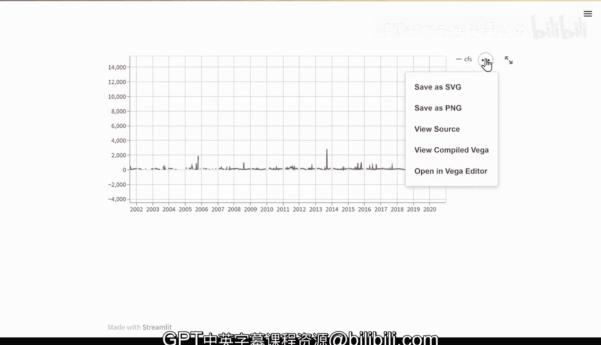

# 杜克大学《应用Python数据工程（3课全）｜Applied Python Data Engineering》中英字幕 p143 44_03_03_使用Streamlit创建折线图.zh_en -BV1nz421i7KP_p143-

To install Stamlit， you can use Pip， just say Pip install Stlit in this case。

 you need to write a script， but instead of using Python to invoke it。

 we're going to use streamamlit， we're going to say streamamlit run after you've installed Strelit。

 you'll have that executable and then you're just going to go to a page to look at that。

Let's look at how to make a line plot with streamlit。Here's our code at the top， we have our imports。

 and then we've got our pandas code。 This looks very similar to what we saw below。

 but the interesting part here is at the bottom we're saying ST do line chart。

 So that is going to add a line chart to streamwi。Let's run this again to run this。

 I'm going to say streamlit run and in the name of the script。Okay， and here is our plot right here。

You can see by default， this is interactive。 We have the ability to pan it around。

 There's also a bunch of actions up here that we can use as well。

