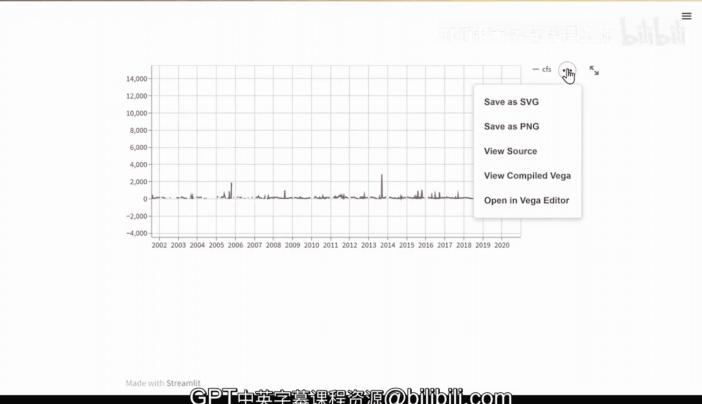

# 杜克大学《应用Python数据工程》：3.3：使用Streamlit创建折线图 📈

在本节课中，我们将学习如何使用Streamlit库快速创建一个交互式的折线图。Streamlit是一个强大的工具，可以让我们用简单的Python脚本构建数据应用。


## 概述

我们将从安装Streamlit开始，然后编写一个包含数据加载和图表创建的Python脚本。最后，我们将运行这个脚本，在浏览器中查看生成的交互式折线图。

## 安装Streamlit

要安装Streamlit，可以使用Pip包管理器。在命令行中执行以下命令即可完成安装。

```bash
pip install streamlit
```

## 创建并运行脚本

安装完成后，你需要编写一个Python脚本。与直接运行Python脚本不同，我们将使用Streamlit来运行它。

运行脚本时，需要使用`streamlit run`命令，后面跟上你的脚本文件名。执行此命令后，Streamlit会启动一个本地服务器，并自动在浏览器中打开一个页面来展示你的应用。

```bash
streamlit run your_script_name.py
```

## 构建折线图代码

现在，让我们看看如何用Streamlit制作一个折线图。以下是核心代码的结构。

在脚本顶部，我们导入必要的库，例如`streamlit`和`pandas`。接着，我们使用pandas进行数据处理，这部分代码与我们之前学习的内容非常相似。

代码最有趣的部分在底部，我们使用`st.line_chart()`函数。这个函数会将一个折线图添加到Streamlit应用界面中。

```python
import streamlit as st
import pandas as pd

# 使用pandas加载或创建数据
# df = pd.DataFrame(...)

# 使用Streamlit创建折线图
st.line_chart(data)
```

## 运行与交互

再次运行这个脚本。在命令行中输入`streamlit run`和脚本名称。

脚本运行后，浏览器中会显示我们的图表。默认情况下，这个图表是交互式的。你可以使用鼠标拖拽来平移视图，图表上方也提供了一系列工具按钮，用于进行缩放、下载图片等操作。

## 总结



本节课我们一起学习了使用Streamlit创建交互式折线图的全过程。我们首先安装了Streamlit库，然后编写了一个简单的脚本，利用`st.line_chart()`函数将pandas数据框可视化为图表，最后通过`streamlit run`命令在浏览器中运行并查看了这个具备平移等交互功能的图表。