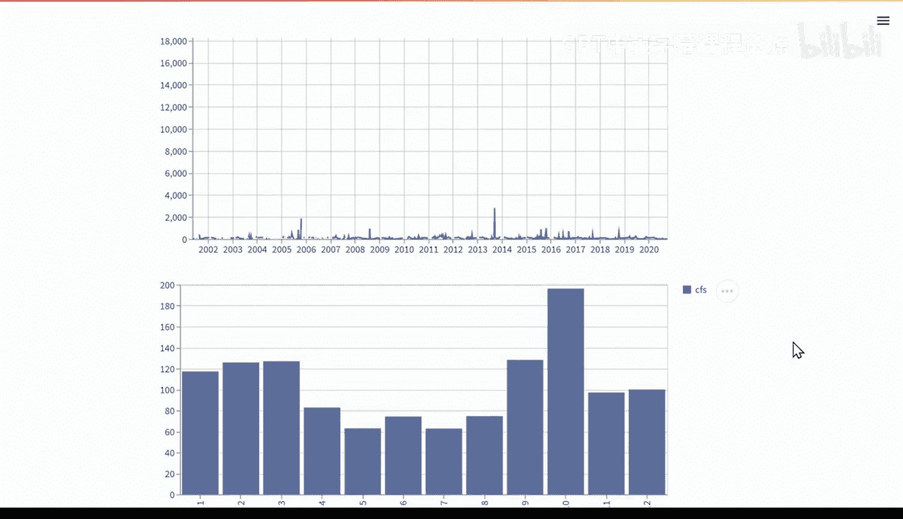

# 杜克大学《应用Python数据工程（3课全）｜Applied Python Data Engineering》中英字幕 p144 45_03_04_使用Streamlit创建条形图.zh_en -BV1nz421i7KP_p144-

In this video， I'm going to show how to make a bar chart with streamrelin。

 Let's look at the code here。At the top， I've got my imports and then I've got some pandas code。

The interesting parts here are that I'm calling line chart and bar chart。 Let's run the code。Okay。

 and here is the plot at the top we've got our line plot and down below we've got our bar plot。

