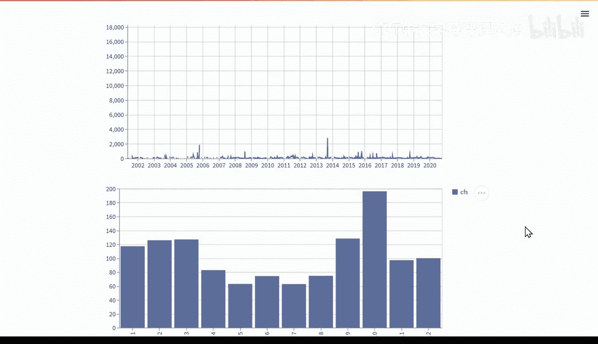

# 应用Python数据工程：3.4：使用Streamlit创建条形图 📊

在本节课中，我们将学习如何使用Streamlit库创建条形图。我们将从导入必要的库开始，然后使用Pandas准备数据，最后通过Streamlit的`st.bar_chart`函数将数据可视化。

---


上一节我们介绍了Streamlit的基本图表功能，本节中我们来看看如何创建条形图。

首先，我们需要导入Streamlit和Pandas库。Pandas用于数据处理，Streamlit用于构建交互式Web应用。

```python
import streamlit as st
import pandas as pd
```

接下来，我们使用Pandas创建一个简单的DataFrame。这个DataFrame将作为我们图表的数据源。

```python
data = pd.DataFrame({
    '月份': ['一月', '二月', '三月', '四月', '五月'],
    '销售额': [100, 200, 150, 400, 300]
})
```

数据准备完成后，我们就可以使用Streamlit来绘制图表了。Streamlit提供了多种图表函数，其中`st.line_chart`用于绘制折线图，`st.bar_chart`用于绘制条形图。

以下是绘制图表的核心代码：

```python
st.line_chart(data.set_index('月份')['销售额'])
st.bar_chart(data.set_index('月份')['销售额'])
```

在这段代码中：
1.  我们首先使用`set_index('月份')`将“月份”列设置为DataFrame的索引。这是为了让图表以月份作为X轴。
2.  然后，我们选择“销售额”列作为图表的数据。
3.  最后，分别调用`st.line_chart`和`st.bar_chart`函数来生成图表。

运行上述代码后，Streamlit应用会启动。在生成的Web页面中，顶部会显示折线图，下方会显示条形图。两个图表都清晰地展示了各个月份的销售额变化趋势。




---

本节课中我们一起学习了使用Streamlit创建条形图的方法。我们首先导入了必要的库，然后用Pandas准备了数据，最后使用`st.bar_chart`函数实现了数据的可视化。通过本课，你可以掌握在Streamlit应用中快速添加条形图的基本技能。