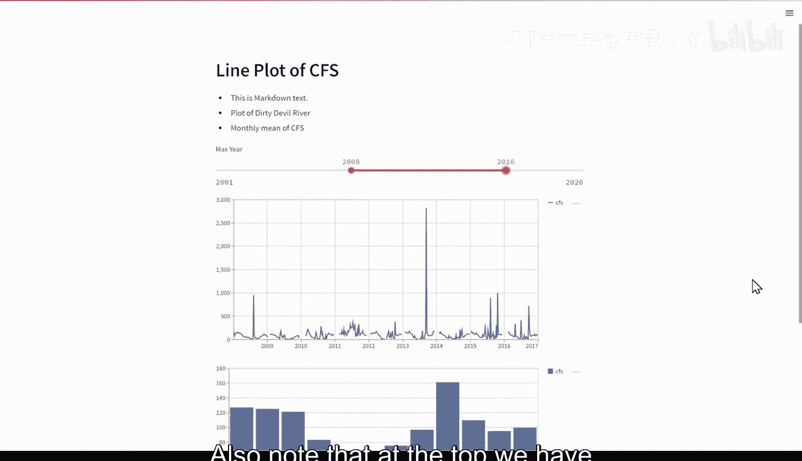
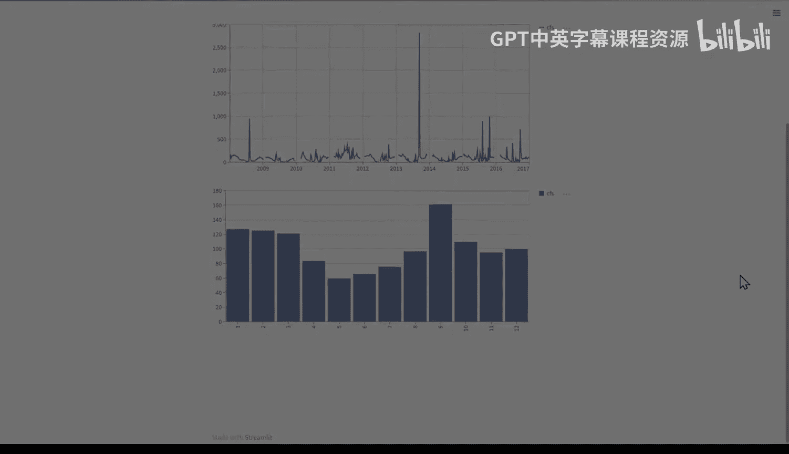

# 杜克大学《应用Python数据工程（3课全）｜Applied Python Data Engineering》中英字幕 p145 46_03_05_在Streamlit中连接控件与图表.zh_en -BV1nz421i7KP_p145-

In this video， we're going to show how to connect a widget to a plot in streamlin。 Here's the code。

 I've got my imports。 I've got my pandas code at the bottom。

 I have some markdown that I'm sticking in there， and then I've got a calculation to calculate the minimum year and the maximum year I'm adding in a slider。

So I'm setting the minimum year and the maximum year and setting a value there。

Cool thing about this slider is that we get both a left hand side and a right hand side from that。

 And then at the bottom here， I am using the result of that year range。

 which is whatever is in the slider to draw my line chart and I'm also doing that to draw my bar chart。

 you can see that I've commented out the code that I had previously。

 And now I'm using this year range tuple to determine what the year range is。

Let's look at what it looks like。Okay， so here we have our slider。

 You can see that we can adjust this。 You can see our line plot and our bar chart are updating。

Also note that the top， we have some markdown that's been rendered as HTML。

