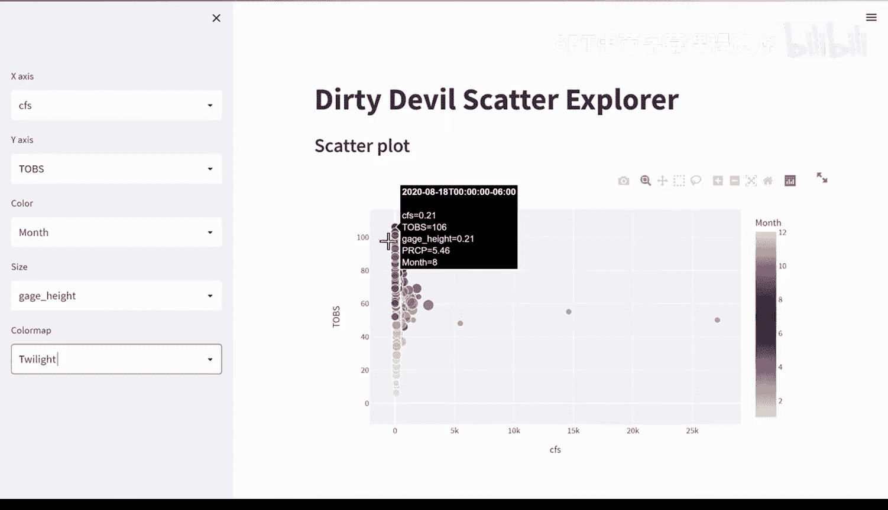

# 杜克大学《应用Python数据工程（3课全）｜Applied Python Data Engineering》中英字幕 p146 47_03_06_使用Streamlit创建散点图.zh_en -BV1nz421i7KP_p146-

In this video， we're going to show how to make a scatter plot with streamlit。 Let's look at the code。

 Okay， here's the code at the top。 We've got our imports。 In this case。

 we are using plotly as the backend previously， Streamlit was using a tool called Vega to do Pting One of the nice things about the streamlit library is that you can change what you are using to plot with。

Okay at the top here I got this git data， I'm using streamamlit to cache that。

 that cache decorator can speed things up that happen to run a lot but return the same data。

You can see a bunch of pandas code here。And I've got a function that's called get Sc。

 It passes in various things that configure what a scatter plot would look like。

 And then I'm returning a plotly。Scatter plot at the bottom here， I've got my markdown。

 I'm creating a bunch of sidebar。 I'm creating a bunch of select boxes。

And then I'm making a scatter plot down below in a subheader。Okay， after running that。

 this is what my plot looks like。 notice that because I am using plotly， I can zoom into these。

 I can come over here， I can change what I am plotting。

I'm going to change my color map here to twilight to make it cyclical， and I'll zoom in。

This video showed how to make a scatter plot and use widgets to control what that looks like。

