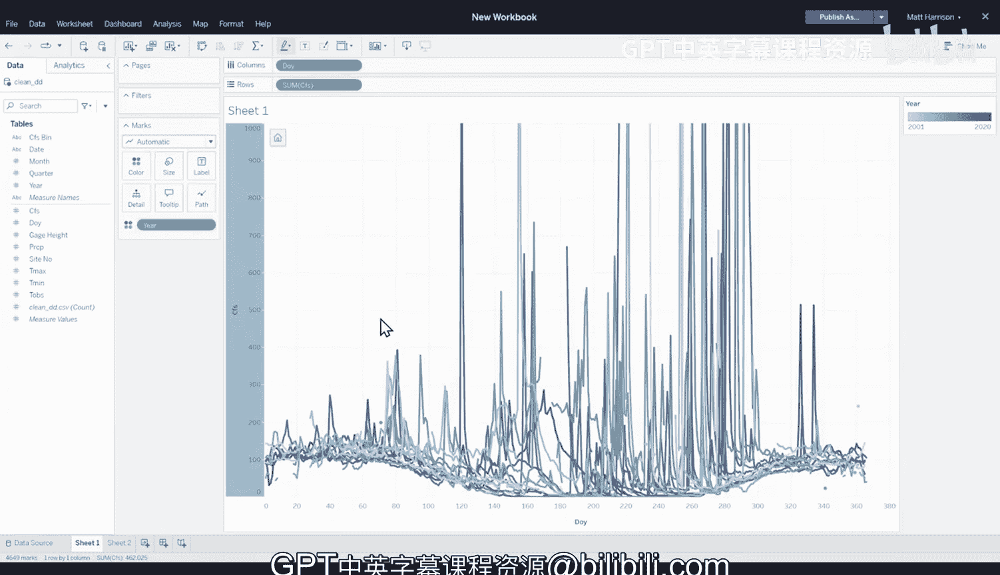

# 杜克大学《应用Python数据工程（3课全）｜Applied Python Data Engineering》中英字幕 p148 49_04_03_使用Tableau创建折线图.zh_en -BV1nz421i7KP_p148-

In this example， we're going to create our line plot from the dirty devil River data set using Tau。

 Okay， so let's plot this。 What we want in the columns is we want the date of the year in the row。

 we want the CFS。And then we want to break these apart by years。

 so we're going to drop year into color right here。Now right now we're getting a scatter plot。

 that's because it thinks that this DOY is a numeric value。

 Let's come down here and we're going to click on this and say it's a dimension。

And now we're getting a line plot there。Okay， that's looking at a little bit better。

 Let's click on this Y axis here。And we'll right click on it。And say edit。

 and we want to come down here to range。 And we're going to say that the range is 0 and it goes up to。

1000。Okay， there is our line plot that we've seen in other tools。

