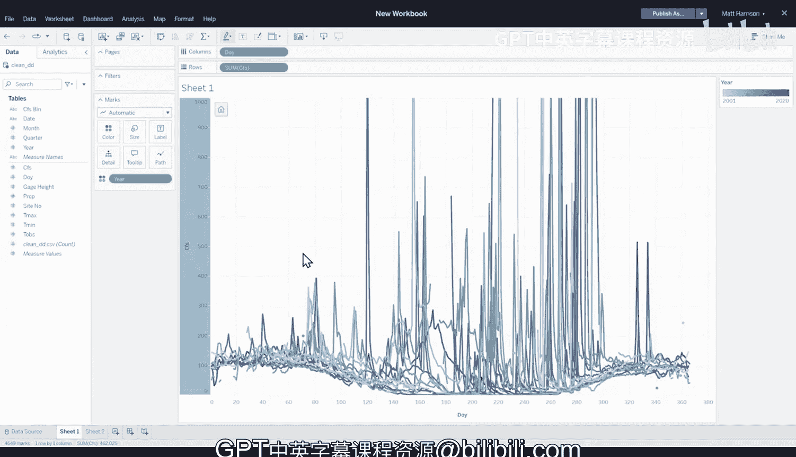

# 数据可视化：04：使用Tableau创建折线图 📈

在本节课中，我们将学习如何使用Tableau软件，基于“脏魔鬼河”数据集创建一个折线图。我们将一步步地设置图表，调整数据字段，并配置坐标轴，以生成清晰的可视化结果。

---

上一节我们介绍了数据可视化的基本概念，本节中我们来看看如何在Tableau中具体操作。

首先，我们需要将数据导入Tableau并开始构建图表。我们的目标是创建一个折线图，其中X轴显示一年中的日期，Y轴显示河流的流量（CFS），并且希望按不同年份用颜色区分各条折线。

以下是创建折线图的具体步骤：

1.  **设置行与列**：在“列”功能区中，放置“一年中的日期”字段。在“行”功能区中，放置“CFS”字段。
2.  **按年份区分颜色**：将“年份”字段拖放至“颜色”标记卡上。此时，图表会开始按年份用不同颜色表示数据。
3.  **调整图表类型**：初始时，图表可能显示为散点图。这是因为软件将“一年中的日期”识别为连续的数值。我们需要将其转换为离散的维度。
4.  **转换字段类型**：点击“一年中的日期”字段，在下拉菜单中选择“维度”。图表将立即从散点图转变为折线图。
5.  **调整Y轴范围**：为了使图表更清晰，我们可以手动设置Y轴的范围。右键点击Y轴，选择“编辑轴”。
6.  **设置固定范围**：在编辑轴的对话框中，找到“范围”选项。选择“固定”模式，并将固定起始值设置为`0`，固定结束值设置为`1000`。

完成以上步骤后，我们就得到了一个清晰的折线图。这个图表与我们之前在其他工具中看到的折线图效果一致，清晰地展示了不同年份下，河流流量随时间的变化趋势。

---

本节课中我们一起学习了在Tableau中创建折线图的完整流程。从设置行列数据、按年份区分系列，到调整字段类型和坐标轴范围，每一步都是构建有效可视化图表的关键。掌握这些基础操作后，你就能利用Tableau对数据进行初步的探索和展示了。