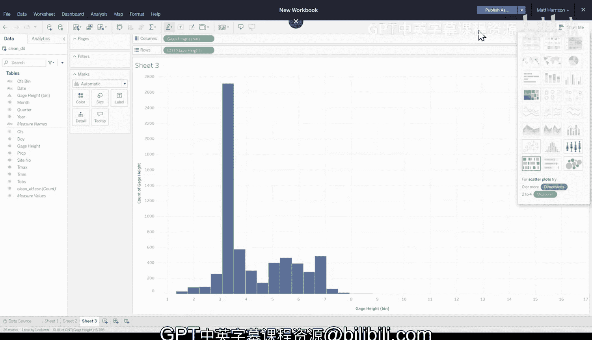

# 杜克大学《应用Python数据工程（3课全）｜Applied Python Data Engineering》中英字幕 p149 50_04_04_使用Tableau创建直方图.zh_en -BV1nz421i7KP_p149-

In this example， we're going to see how to make a histogram using Tau。

 Come over here and click new sheet。And we're going to come down here。

We're going to drag gauge height to columns。Now we don't have a histogram right now。

 what we're going to do is we're going to click this show me up here and we're going to come down here and say measure。

 and we want a histogram right there。Okay so if you pay attention here。

 you can see that it's actually kind up here and it's changed this and said that we're bendning the gauge height and we're actually doing count of the gauge height in the rows。

 so that's how it came up with the histogram right there。

