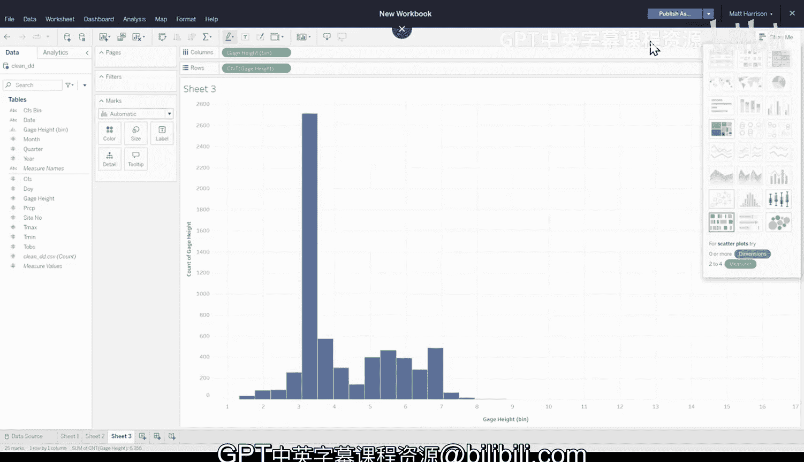

# 数据可视化：04：使用Tableau创建直方图 📊


在本节课程中，我们将学习如何使用Tableau软件创建一个直方图。直方图是一种用于展示数据分布情况的图表，特别适用于观察连续数据的频率分布。

## 概述

我们将通过一个具体的例子，演示在Tableau中从新建工作表到生成直方图的完整步骤。整个过程涉及将数据字段拖放到指定区域，并通过菜单选项调整图表类型。

## 创建直方图步骤

以下是创建直方图的具体操作流程。

1.  首先，在Tableau界面中点击“新建工作表”按钮。
2.  接着，在数据面板中找到“gauge height”（测量高度）字段，将其拖放至工作区的“列”功能区。
3.  此时，视图区域并不会直接显示直方图。我们需要点击界面右上角的“显示我”面板。
4.  在该面板中，找到并选择“度量”选项，然后点击其中的“直方图”图表图标。
5.  完成上述操作后，一个直方图便成功生成了。

## 图表原理说明

观察生成后的工作表，可以发现Tableau自动执行了两个关键操作，其逻辑可以用以下伪代码表示：

```python
# Tableau 创建直方图的内部逻辑示意
binned_data = bin(original_data['gauge_height']) # 将连续数据分箱
histogram_data = binned_data.value_counts() # 计算每个箱体的数据计数
```

具体来说，软件自动将“gauge height”字段进行了**分箱**处理，并在行功能区生成了**“gauge height的计数”**。直方图的X轴代表了分箱后的数据区间，Y轴则代表了每个区间内数据点的数量，图表由此绘制而成。

## 总结



本节课我们一起学习了在Tableau中创建直方图的方法。关键步骤包括：将数据字段拖入列功能区，并通过“显示我”面板选择直方图类型。Tableau会自动完成数据分箱和计数，从而直观地展示出数据的分布情况。