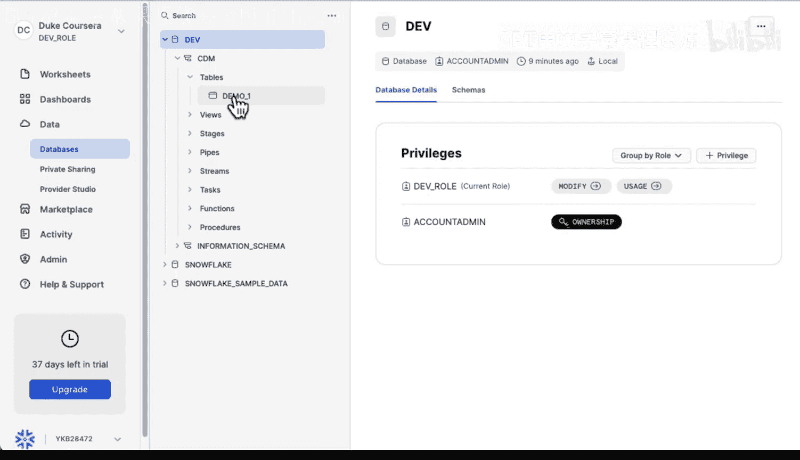

# 杜克大学《应用Python数据工程（3课全）｜Applied Python Data Engineering》中英字幕 p15 15_02_03_在Snowflake中创建表.zh_en -BV1nz421i7KP_p15-

Here we are back in the Snowflake console。 Now we can see in the upper left of the console。

 we have our username。And the roll we're currentlyly using。

Now we can switch roles to any role that our user has access to。

Because this user is the accounted Min。 it has access to all of the roles， but in a normal setup。

 your user will probably be limited to certain specific roles。

Now we've already seen in the data section。That there are databases。

These are the databases that come。Built as example data here。

 and this is snowflake related administrative data。But we can create our own database at this point。

Then if we select our database， we can see the available。Schema is。We can create a new schema。

These are the default schemas that come with every database。Now we see we have three schemas。

 Here's our new schema。Can select it。And in that schema。We have no tables yet。

But we can create a table。And you can see that it gives us the SQL statement we need to fill out to create the table。

So we'd create the table using the column names， column types。Any comment we wanted？

So now in our tables list， we have our new table demo1。One thing to note。

We change roles to a role with different permissions。We can no longer see。

These schemas are tables that we just created with our adminral。Go back to ourdminral。

We can actually look at the schemo。And you can see the privileges。

 so this schema only has privileges to the owner。Which is the accounted men。We can add privileges。

For a specific rule。So let's add for。Deeveril。You can see， there's a。

Great number of privileges to choose from。And we can do the same with the table。

When choosing privileges in this interface。Be sure to select the Gr optiontion checkbox。

We also need to grant privileges for the database itself if we want another role to be able to use it。

Now， if we go back to our devilil。If we refresh， we can now see the schema and the new table。

It's important when creating tables and schemas and other objects and the snowflake to keep in mind that the owner of these objects will have access to them if you have other roles that need access。

Their access will need to be granted。