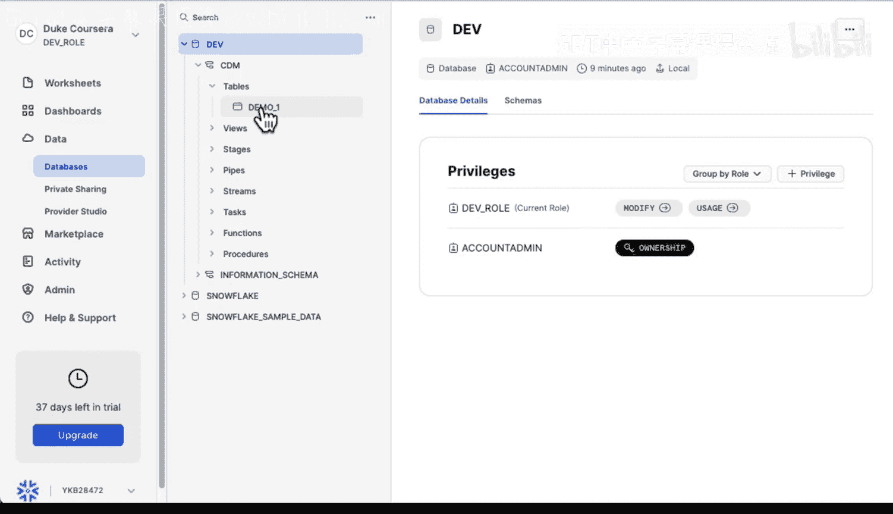

# Snowflake数据工程：第15课：在Snowflake中创建表 🏗️

在本节课中，我们将学习如何在Snowflake控制台中创建数据库、模式和数据表，并理解如何通过角色和权限来管理对这些对象的访问。

## 概述

我们将首先登录Snowflake控制台，然后逐步创建一个新的数据库、一个新的模式，并在该模式中创建我们的第一个表。最后，我们将探讨权限管理，确保其他角色也能访问我们创建的资源。

## 创建数据库与模式

现在，我们回到了Snowflake控制台。在控制台的左上角，我们可以看到当前登录的用户名以及正在使用的角色。

我们可以将角色切换到用户有权访问的任何角色。由于当前用户是账户管理员，因此可以访问所有角色。但在常规设置中，用户通常仅限于某些特定角色。

在“数据”部分，我们已经可以看到现有的数据库。这些是Snowflake内置的示例数据库，其中也包含与Snowflake管理相关的数据。现在，我们可以创建自己的数据库。

选择我们创建的数据库后，可以看到可用的模式。我们可以创建一个新的模式。每个数据库都带有一些默认的模式。

## 创建数据表

现在，我们看到了三个模式，其中包括我们新建的模式。选择这个新创建的模式，可以看到其中还没有任何表。

我们可以开始创建表。界面会提供我们需要填写以创建表的SQL语句。创建表时，我们需要指定列名、列类型以及可选的注释。

在我们的表列表中，现在有了新表 `demo1`。

## 权限管理

有一点需要注意：如果我们切换到具有不同权限的角色，将无法看到之前用管理员角色创建的这些模式和表。

切换回管理员角色，我们可以查看模式的详细信息，包括其权限。可以看到，此模式目前只对所有者（即账户管理员）拥有权限。

我们可以为特定角色添加权限。例如，为 `DEVELOPER` 角色添加权限。在权限选择界面中，有大量权限可供选择。对表也可以进行同样的权限设置。

在使用此界面选择权限时，请务必选中“授予”选项的复选框。如果我们希望其他角色也能使用该数据库，同样需要为其授予数据库本身的权限。

现在，如果我们切换回 `DEVELOPER` 角色并刷新页面，就可以看到之前创建的 schema 和新表了。

在Snowflake中创建表、模式和其他对象时，务必牢记：这些对象的所有者将拥有访问权限。如果有其他角色也需要访问，则必须明确授予它们相应的权限。

## 总结

本节课中，我们一起学习了在Snowflake控制台中创建数据库、模式和表的基本流程。关键步骤包括使用合适的SQL语句定义表结构，以及通过权限管理界面为不同角色授予必要的访问权限。理解所有权与权限授予是管理Snowflake数据对象的核心。