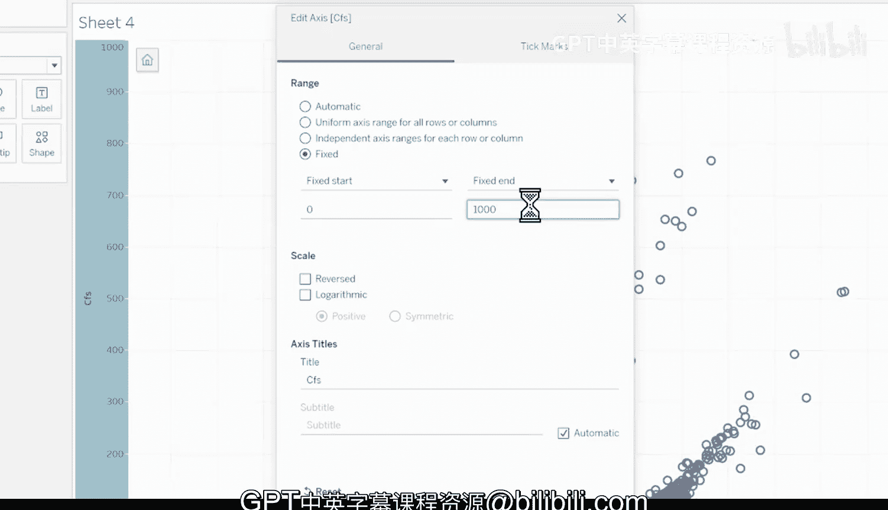

# 杜克大学《应用Python数据工程（3课全）｜Applied Python Data Engineering》中英字幕 p150 51_04_05_使用Tableau创建散点图.zh_en -BV1nz421i7KP_p150-

In this example， we're going to do a scatter plot and tableau to make a new sheet。

And we're going to drag gauge height to columns。We're going to drag CFS to rows。Now。

 that's not looking quite like what we want。We can click on scatter plot right here and show me and it is still not looking like what we want。

 The reason is is because it's summing these values， So it's doing an aggregation here。

 Let's click over here on this right edge and change this into a dimension。

And we'll also change this into a dimension。Okay， there we go。

 there's our scatter plot we're going to right click on this and say edit access。

We're going to come down here to the range。 We'll click on fixed， and we're going to put this from0。

2，1000。

