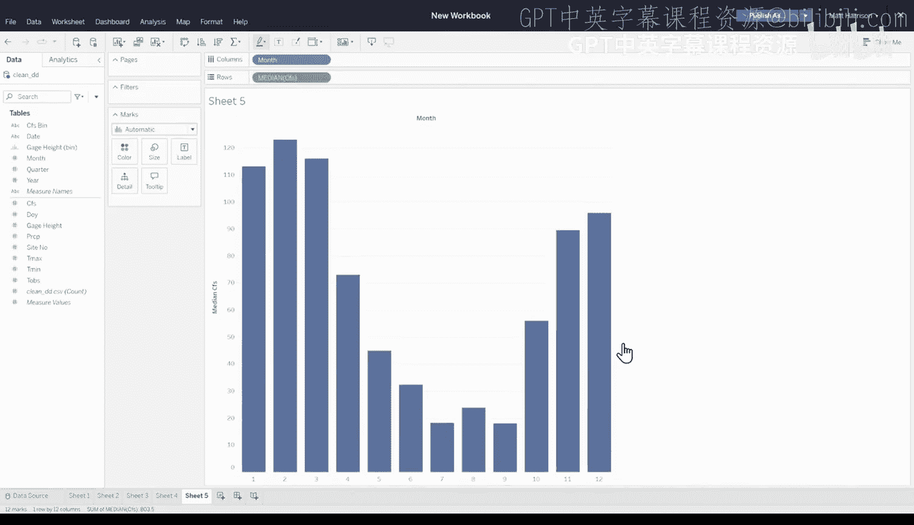

# 杜克大学《应用Python数据工程（3课全）｜Applied Python Data Engineering》中英字幕 p151 52_04_06_使用Tableau创建条形图.zh_en -BV1nz421i7KP_p151-

In this example， we're going to see how to make a bar plot using Tableau。 Let's make a new sheet。

We're going to summarize the median cubic feet per second per month。

We're going to drag months onto columns。We're going to right click this and we're going to click that this is a discrete value。

 we want this to be a category rather than a continuous value there。

And then we're going to take CF as we're going to throw this into rows。

You can see that right now it is summing this， we can click on this and we can come down to measure here and click on median。

Awesome。

